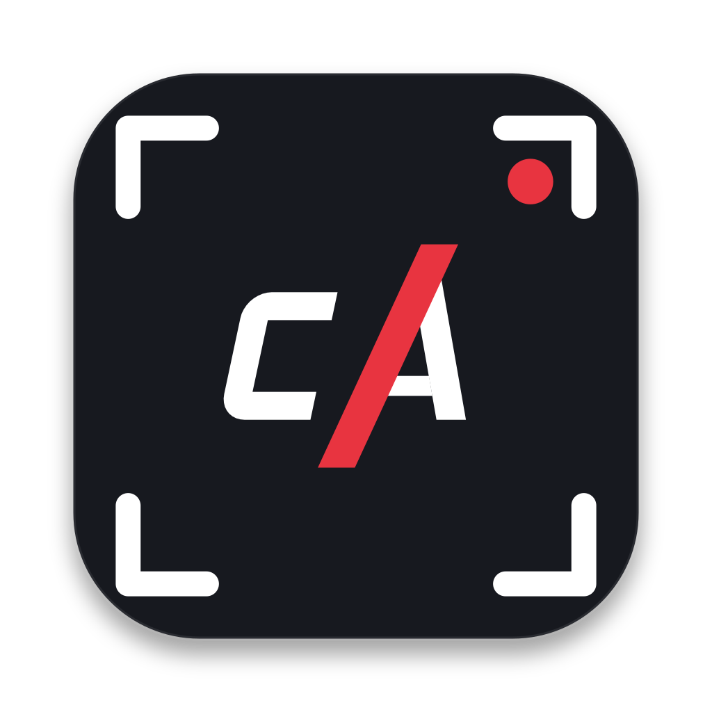
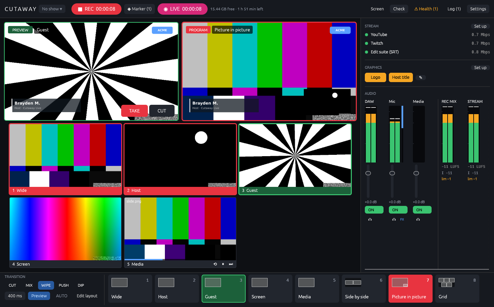

# Cutaway

A software take on hardware production consoles like the RØDECaster Video. It
captures any number of video sources at once, records each one to its own file,
and lets you switch a composited program feed live. It records the audio coming
from your DAW, both as WAV and inside the video files, and streams the program
to as many places as you like at once.

Cutaway is a single native app for **macOS** (Apple Silicon) and **Windows
11**. Capture, GPU compositing, hardware encoding, file writing, streaming,
the web remote and MIDI are all built in, using the media frameworks that
come with each system. There is nothing else to install: no GStreamer, no
FFmpeg, no drivers. (NDI sources and the virtual webcam are optional extras;
see [Installing Cutaway](docs/guide/install.md).)

*Preview/program mode: picture-in-picture is on air with a logo and a name
title, the Guest camera waits in preview, and the program is recorded and live
on three destinations.*

## Download

Get the newest version from the
**[Releases page](https://github.com/braydenm32/cutaway/releases/latest)**:

| For | Download |
|---|---|
| Mac with Apple Silicon (M1 or later), macOS 13 or newer | `Cutaway-<version>-macos-arm64.zip` |
| Windows 11, 64-bit | `Cutaway-<version>-windows-x64.zip` |
| Stream Deck (Mac or Windows) | `Cutaway.streamDeckPlugin` |

**Windows is new:** it passes the same tests as the Mac on every change, but
it hasn't been used on a Windows PC with real cameras yet.

- **Mac:** unzip, move **Cutaway.app** to Applications and open it. It's
  signed and checked by Apple, so it opens like any other app.
- **Windows:** the Windows app isn't signed yet, so the first launch takes one
  extra step. Unzip anywhere and run **Cutaway.exe**. When Windows says it
  "protected your PC", choose **More info → Run anyway**.

> **Windows won't open it?**
> - **No "Run anyway" button:** Smart App Control may be on. Open **Windows
>   Security → App & browser control → Smart App Control**. While it's **On**,
>   Windows blocks apps that aren't signed, and Cutaway isn't yet. Turning it
>   off lets Cutaway run, but Windows can't turn it back on without a reset,
>   so decide whether that's right for this PC.
> - **Cutaway.exe vanished or "contains a virus":** Microsoft Defender
>   sometimes flags new, unsigned apps. Open **Windows Security → Virus &
>   threat protection → Protection history**, check it's Cutaway, and choose
>   **Allow on device**. Then unzip again.
> - **Nothing happens at all:** make sure you unzipped the whole folder first
>   (running it from inside the zip doesn't work).

### What it needs

| | Smallest | Comfortable (several cameras, 4K) |
|---|---|---|
| Mac | Apple Silicon (M1), 8 GB memory, macOS 13 | M1 Pro/Max or newer, 16 GB |
| Windows | Windows 11 64-bit, a graphics card with a video encoder (NVIDIA GTX 1050 or newer, AMD RX 5000 or newer, Intel 7th-generation graphics or newer), 8 GB memory | NVIDIA RTX, recent AMD or Intel Arc, 16 GB |
| Drive | An SSD with room for the show: about 6 GB an hour for each 1080p file | A fast external SSD for 4K and many files |
| Network (streaming) | Upload speed about 1.5 times the stream's bitrate | |

These are a guide, not a promise: the work depends on how many files you
record and their size. The pre-show check adds them up and says when a show
may be too much for the computer.

When a newer version comes out, Cutaway shows a blue dot on **More** in the
rail and says so in **More › App › Updates & about** (it asks GitHub once
when it starts; turn that off in More › App › General).
From 0.8 on, **Update now** there downloads it inside Cutaway,
checks it against the release's fingerprints (and, once updates are signed,
that those fingerprints are signed by Cutaway's maker) and makes sure it
starts; then
**Restart to update** (once recording and streaming have stopped) or **When
I quit** puts it in place. The previous version is kept until the new one
has run for a few seconds, and comes back by itself if the new one doesn't
start. Tick **download it by itself, and put it in when I quit** (More › App ›
General › Updates) to have every update arrive that way. If Cutaway
can't change its own folder (an account without administrator rights on a
Mac, say), the notice takes you to the download page instead; on Windows,
moving the Cutaway folder somewhere of your own (Documents, the Desktop) lets
it update itself again. If an update can't go in (another program such as
OBS or Zoom is holding Cutaway's webcam, say), Cutaway says what to do. On Windows, an
update that changes the virtual camera asks you to reinstall it (Record & stream ›
Screens & webcam), which needs administrator rights once.
Your settings, shows and recordings stay as they are when you update.
If Cutaway can't reach its releases page at all, **Updates & about** says it
can't check, rather than that you're up to date.
To see which version you have, click the logo at the top left (**About
Cutaway**, with links to what's new and to the manual).
To build Cutaway yourself instead, see [Install on a Mac](docs/guide/install.md#install-on-a-mac)
and [Install on Windows](docs/guide/install.md#install-on-windows).

## New to Cutaway?

Start with **[Your first hour](docs/guide/first-hour.md)**. It covers what
your computer needs, getting past the first-launch warning, the permissions
to allow, where your files go, what Cutaway sends over the internet, and
the ten things most likely to go wrong in a first show, with their fixes.
Then the first-show guide inside the app walks you through cameras, people,
sound, scenes and a test recording.

## The manual

The **[Cutaway manual](docs/guide/README.md)** has everything, one page per
part of the show. Inside the app, **Help** (More › App) and the **Manual**
button on About open it.

- [Your first hour](docs/guide/first-hour.md)
- [What Cutaway does](docs/guide/features.md): every feature, area by area
- [Installing Cutaway](docs/guide/install.md): Mac and Windows, the virtual camera, NDI
- [Getting started](docs/guide/getting-started.md): the first run, finding your way, and what to do if something goes wrong
- [Running a show and going live](docs/guide/running-a-show.md)
- [Network, phone and PTZ cameras, framing and backgrounds](docs/guide/sources.md)
- [Remote guests](docs/guide/guests.md)
- [Remote control, Stream Deck, OSC and MIDI](docs/guide/control.md)
- [Show tools and sound](docs/guide/show-tools.md): replay, macros, the teleprompter, sound pads, your DAW, captions, the vertical version
- [After the show: uploads and editing](docs/guide/after-the-show.md): YouTube, Google Drive, DaVinci Resolve, Premiere Pro, Final Cut and REAPER
- [Performance: 4K and many sources](docs/guide/performance.md)
- [Privacy](docs/guide/privacy.md): what Cutaway keeps, what it sends, your guests, and removing it all

## Getting help

When something goes wrong, the [Getting started](docs/guide/getting-started.md#if-something-goes-wrong)
page says where to look. To report a problem, use **More › App ›
Diagnostics → Save a problem report…**. It saves one .zip with the log, your
settings and the devices found, with stream keys and passwords taken out.

## For developers

Cutaway is written in Rust, with an [egui](https://github.com/emilk/egui)
interface and a [wgpu](https://wgpu.rs) compositor (Metal on a Mac, DirectX
12 on Windows). How it works, building and testing it, signing releases and
what has been tested where are in **[DEVELOPING.md](docs/DEVELOPING.md)**.
