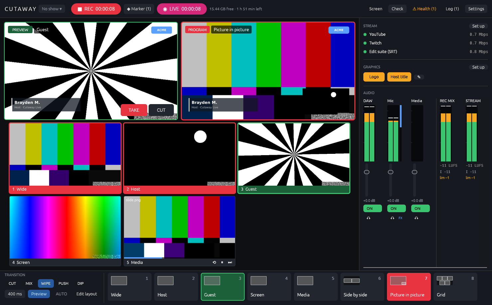
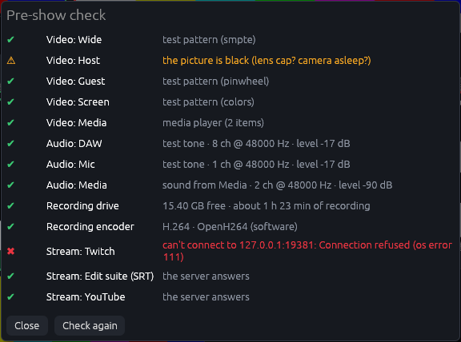
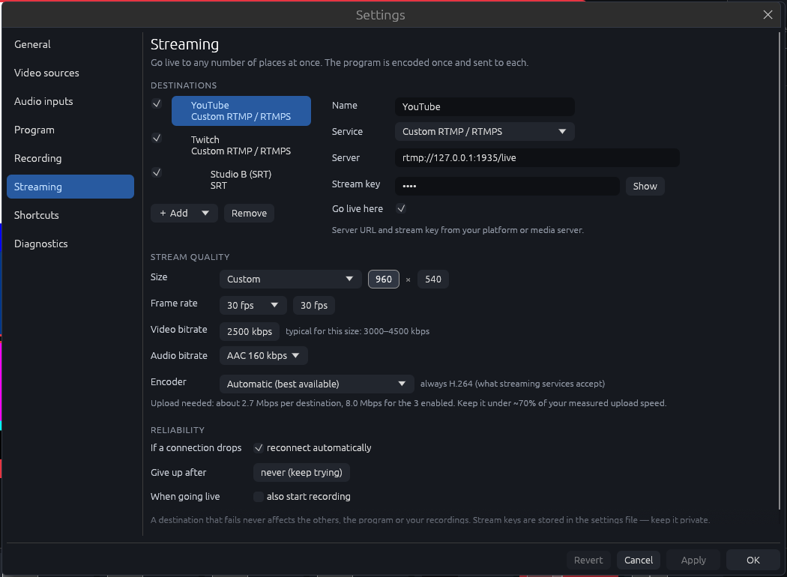
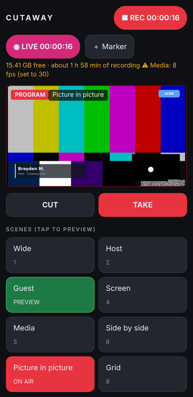
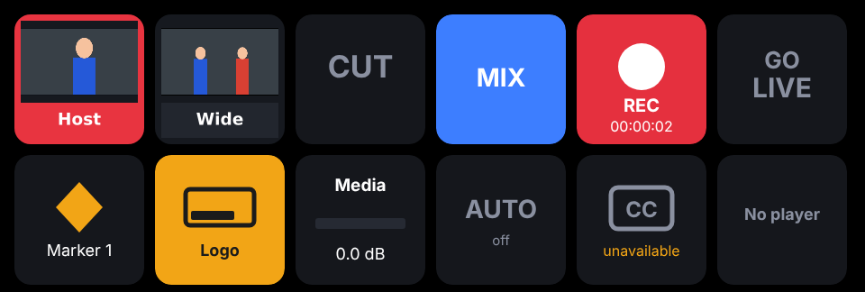
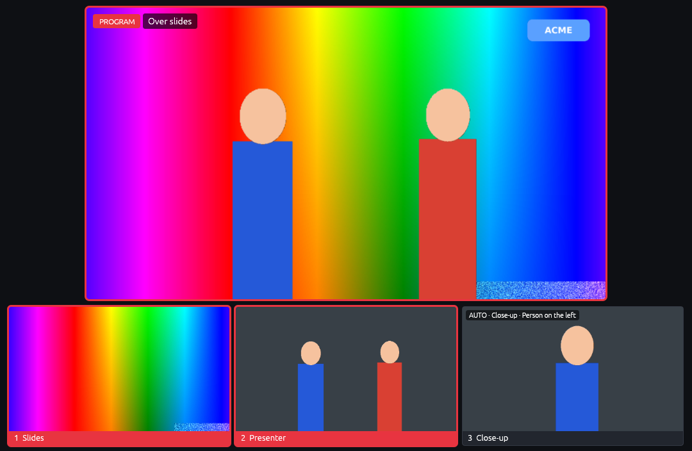

# Cutaway

A software take on hardware production consoles like the RØDECaster Video. It
captures any number of video sources at once, records each one to its own file,
and lets you switch a composited program feed live. It records the audio coming
from your DAW, both as WAV and inside the video files, and streams the program
to as many places as you like at once.

Cutaway is a single native app for **macOS** (Apple Silicon) and **Windows
11**. Capture, GPU compositing, hardware encoding, file writing, streaming,
the web remote and MIDI are all built in, using the media frameworks that
come with each system. There is nothing else to install: no GStreamer, no
FFmpeg, no drivers. (NDI sources and the virtual webcam are optional extras;
see below.)

Written in Rust, with an [egui](https://github.com/emilk/egui) interface and a
[wgpu](https://wgpu.rs) compositor (Metal on a Mac, DirectX 12 on Windows).


*Preview/program mode: picture-in-picture is on air with a logo and a name
title, the Guest camera waits in preview, and the program is recorded and live
on three destinations.*

## What it does

### Sources

- **Any source, many at once.** Webcams, USB/Thunderbolt capture cards and
  cameras over HDMI capture (if QuickTime Player can see it, Cutaway can), the
  screen, or test patterns. There is no fixed limit; 4K sources are supported.
- **Network sources.** Take a feed from another computer, a phone app or an
  encoder over the network:
  - **RTMP in:** Cutaway runs its own RTMP server (`rtmp-in:1935/key`); point
    OBS, Larix, a hardware encoder or another Cutaway at it.
  - **SRT:** listen for a sender (`srt-in:9000`) or call one
    (`srt://host:port`).
  - **NDI:** any NDI source on the network (`ndi:Name`), once the free NDI
    runtime is installed (see [NDI](#ndi)).
  - Each network source has a fixed latency buffer so its picture and sound
    stay in step with your cameras.
- **Media player.** A source that plays a playlist of video files and still
  images, with sound: intros, stings, holding slides, B-roll. Play, pause,
  next and restart from its tile, the remote or MIDI; optionally restart when
  it goes on air.
- **Devices that come back.** A camera, capture card or interface that's
  unplugged is marked offline and reopened automatically when it returns,
  without touching anything else.
- **Auto-framing:** a virtual close-up cut from one wide (ideally 4K)
  camera that follows the people in it — everyone, the closest person, or
  whoever is on the left, in the middle or on the right — and glides to a
  new framing like a camera operator. It's a source like any other: switch
  it, record it, key it.
- **Background removal without a green screen:** cut the people out of any
  source and put them over slides, a background image or another camera.
- **Frame fixes per source:** crop, mirror, brightness, contrast, saturation,
  and a **green-screen key** with spill suppression.

### Recording

- **One file per source (ISO recording)** plus a `Program` file with the
  switched show. Every file starts at the same instant, has a constant frame
  rate, and carries the program audio, so multicam sync in an editor is
  instant.
- **Codecs:** H.264 or H.265 in MP4/MOV, or **Apple ProRes** 422 Proxy, LT,
  422 or HQ (in MOV) on Macs whose media engine encodes it.
- **Proxies:** optional small H.264 copies of every video file in a `Proxies`
  folder, for smooth editing on a laptop.
- **Backup drive:** optionally write a second copy of every file to another
  drive as it records. If the backup drive fails, the main recording carries
  on.
- **Timecode:** every file is stamped with time-of-day timecode (and the WAVs
  with Broadcast WAV timestamps), so editors line them up automatically.
- **Markers:** press `M` (or the Marker button, the remote, MIDI) to mark a
  moment. Markers become chapters in the files, markers on the exported
  timelines, and a ready-to-paste YouTube chapter list.
- **Every input on its own track:** optionally, the Program file carries
  each audio input as its own (disabled) track after the mix, so an editor
  can re-balance the show without the WAVs.
- **Podcast episode:** optionally, each take also gives an M4A of the mix,
  levelled to −16 LUFS (or your target) with a look-ahead limiter, tagged,
  with the markers as chapters — ready to upload.
- **Transcripts:** with captions on, each take gets `Transcript.txt`
  (time-stamped) and `Captions.srt` / `.vtt` subtitle files.
- **Editor timelines:** every take includes a Final Cut Pro / DaVinci Resolve
  timeline (`.fcpxml`) and a Premiere Pro timeline (`.xml`) of the live edit,
  with every camera angle on hand to change any cut.
- **Disk health:** shows the space left in hours and minutes, warns at 30 and
  10 minutes, and finishes the files cleanly before the drive is full.
- **Crash-safe.** Video files are written in one-second pieces. After a crash
  or power cut, the next start turns them back into normal files and repairs
  the WAVs, so you keep everything up to the last second.

A take looks like this:

```
Take_2026-10-16_19-30-02/
  Program.mp4                        the switched show (+ program audio)
  ISO_01_Wide.mp4                    each source, full quality (+ program audio)
  ISO_02_Host.mp4
  ISO_03_Guest.mp4
  Audio_01_DAW.wav                   every channel captured from the interface
  Mix.wav                            the recording mix (if turned on, or for the podcast)
  Take_… (Podcast).m4a               the levelled episode with chapters (if turned on)
  Transcript.txt, Captions.srt/.vtt  what was said (with captions on)
  Proxies/                           small copies (if turned on)
  Take_2026-10-16_19-30-02.fcpxml    the live edit for Final Cut Pro / Resolve
  Take_2026-10-16_19-30-02 (Premiere).xml
  Chapters.txt                       markers as a YouTube chapter list
  Switches.csv                       timecode, scene, transition for every switch
  Take.txt                           devices, encoders, settings, markers, files
```

### Switching and graphics

- **Scenes.** Preset scenes (each source full screen, side by side,
  picture-in-picture, grid) plus your own: drag and resize frames live, then
  save them.
- **Transitions:** Cut, Mix (shared frames glide to their new places while
  others fade), Wipe, Push and Dip to a colour, with a direction and length.
- **Preview/program:** optionally pick the next scene in a preview monitor
  first, then **Take** (Space) or **Cut** (Enter), like a hardware switcher.
- **Automatic switching:** follows whoever is talking, from each person's mic
  channel, with a minimum shot length, a wide shot for crosstalk or long
  shots, and a pause after you switch by hand.
- **Frame styling:** rounded corners, borders and drop shadows on framed
  sources (they disappear smoothly as a frame grows to full screen).
- **Graphics:** logos/watermarks (PNG with transparency) and name titles
  (lower thirds) above every scene, each with its own button and fade. Title
  text can be changed live between guests.
- **Tally:** red for on air, green for preview, in the multiview, on the
  phone remote and on MIDI pads.

### Audio

- **DAW audio.** Each audio input is recorded to WAV (multichannel, or one mono
  file per channel). You pick which two channels feed the mix. Interfaces with
  their own clock are kept locked to the video for hours (drift correction).
- **Voice processing** per input: high-pass filter, noise gate, three-band EQ,
  compressor and de-esser, with a gain-reduction meter on the strip.
- **Two mixes:** the recording mix and the stream mix. Each input can go to
  both or just one (e.g. a talkback mic that's recorded but never streamed).
- **Loudness:** LUFS meters (momentary, short-term and integrated) for both
  mixes, a safety limiter, and optional **stream levelling** that slowly
  brings the stream to −14 LUFS without pumping.
- **Scene audio:** scenes can turn inputs on or off when they're taken (a
  break scene that mutes the mics and brings up the music), in sync with the
  picture.
- **Headphones:** listen to either mix, or solo any input, on any output
  device, in sync with the program picture.
- **Automatic lip sync:** clap once where every camera can see it; Cutaway
  finds the clap in every picture and every input and sets each delay (or
  set the delays by hand).

### Outputs

- **Live streaming to many places at once:** YouTube, Twitch, Facebook, Kick,
  any RTMP/RTMPS server, or SRT. The program is encoded once and sent to every
  destination. A destination that drops reconnects on its own; the others and
  your recordings carry on untouched.
- **Second screen:** the program or the multiview, full screen on a
  projector, TV or confidence monitor.
- **Live captions:** speech recognised on the Mac (nothing leaves it),
  shown on the stream (and optionally burned into the recording), from the
  mix or any one input.
- **Virtual webcam:** the program as a "Cutaway" camera in Zoom, Teams, Meet,
  FaceTime and others (macOS 13+; needs a one-time signing step, see
  [Virtual camera](#virtual-camera)).

### Control

- **Keyboard** shortcuts for everything you do during a show.
- **Phone and tablet remote:** a web page served by Cutaway, on any device on
  the same network, with a PIN. Program picture, scenes, take/cut, record,
  live, markers, graphics, mics, media player, plus **tally pages** for
  phones mounted on cameras.
- **Stream Deck plugin:** keys with live pictures of every scene and source,
  red and green tally, take/cut, transitions, record and go live (hold to
  confirm), markers, graphics, audio inputs with level meters (and Stream
  Deck+ dials for levels), auto-switching, captions and media players.
- **Show-control software:** OSC from QLab, Bitfocus Companion, TouchOSC or
  a lighting desk, with state sent back; a WebSocket API that pushes every
  change; and every action is also a plain web address.
- **MIDI controllers:** map pads, keys and faders with Learn; pads light up to
  show what's on air.
- **Show profiles:** save complete setups (sources, scenes, audio, graphics,
  streaming) per production and switch between them from the header.
- **Pre-show check:** one button checks every source for a picture, every
  input for sound, the disk, the encoder, and that every stream server
  answers. It can run automatically before recording or going live.



## Install on a Mac

Needs a Mac with Apple Silicon (M1 or later) and macOS 13 Ventura or newer.

1. **Command line tools:** in Terminal, run `xcode-select --install` (skip if
   you already have Xcode).
2. **Rust:** install it from https://rustup.rs, then add the Apple Silicon
   target:
   ```sh
   rustup target add aarch64-apple-darwin
   ```
3. **Build the app:** inside this folder, run:
   ```sh
   ./macos/bundle.sh --install
   ```
   This builds `Cutaway.app` and copies it to Applications. Without
   `--install` it stays in `target/Cutaway.app`.

   **Or download GitHub's build:** in the repository, **Actions → macOS →**
   the newest run **→ Artifacts → Cutaway-macos-arm64**. Unzip it (it holds a
   second zip with the app), move `Cutaway.app` to Applications and open it.
   It isn't signed by an Apple developer, so macOS refuses the first time:
   go to **System Settings → Privacy & Security** and choose **Open Anyway**
   (once per new build).
4. **Permissions:** on first launch, macOS asks for camera and microphone
   access. Allow both. For screen sources, also turn Cutaway on in **System
   Settings → Privacy & Security → Screen Recording**, then reopen the app.
   The first time you use the phone remote, a network source or a stream
   server on your network, macOS 15 and later ask for **Local Network**
   access, and the firewall (if it's on) asks about incoming connections.
   Allow both. Turning on live captions asks for **Speech Recognition**.

You can also run it straight from Terminal, which is handy for the
command-line options below:

```sh
cargo run --release -- --list-devices
cargo run --release
```

### Virtual camera

macOS only runs camera extensions from apps signed with a paid Apple
Developer account, so the virtual camera needs a one-time signing step. Skip
this if you don't need it; everything else works without it.

1. In your [Apple Developer account](https://developer.apple.com/account),
   create an App ID `app.cutaway.Cutaway` with the **System Extension**
   capability, and an App ID `app.cutaway.Cutaway.Camera`.
2. Create a **Developer ID** provisioning profile for `app.cutaway.Cutaway`
   and download it.
3. Build and sign:
   ```sh
   ./macos/bundle.sh
   ./macos/virtualcam/build.sh "Developer ID Application: Your Name (TEAMID)" TEAMID ~/Downloads/Cutaway.provisionprofile
   ```
4. Copy `target/Cutaway.app` to `/Applications` (camera extensions only load
   from there), open it, and choose **Settings → Screens & webcam →
   Install…**. Approve the extension in System Settings if asked (Privacy &
   Security on macOS 13–14; General → Login Items & Extensions on macOS 15
   and later).
5. Press **Webcam** in the header. In the video-call app, choose the
   **Cutaway** camera, and your interface or a loopback device as the
   microphone.

### NDI

NDI is optional. Install the free **NDI Tools** (or the NDI SDK) from
[ndi.video](https://ndi.video/tools/); Cutaway finds the NDI runtime on its
own. Then choose **NDI** as a source's type in **Settings → Video sources**
and pick from the senders it finds.
Cutaway doesn't include any NDI code, so nothing changes if it isn't
installed.

## Install on Windows

Needs Windows 11 (64-bit, Intel or AMD) and a DirectX 12 graphics card.
**The Windows version is new in 0.5:** it's built from the same code as the
Mac version and compiles for Windows, but hasn't been run on a Windows PC yet.
Expect some tuning on first contact; the log
(`%LOCALAPPDATA%\Cutaway\Logs\Cutaway.log`) and the Health window are the
places to start.

1. **Tools, once:** [Rust](https://rustup.rs) and the
   [Visual Studio Build Tools](https://visualstudio.microsoft.com/visual-cpp-build-tools/)
   with **Desktop development with C++** (it includes CMake). For ASIO
   interfaces, also LLVM: `winget install LLVM.LLVM`.
2. **Build:** in this folder, in PowerShell:
   ```powershell
   powershell -ExecutionPolicy Bypass -File windows\build.ps1
   ```
   The first time, it downloads ONNX Runtime (for auto-framing and
   background removal) and Steinberg's ASIO SDK. The result is
   `dist\Cutaway` (run `Cutaway.exe`) and a zip of it to copy to other PCs.
   `-NoAsio` builds without ASIO.
3. **Or download GitHub's build:** on each push, the repository's workflow
   builds Cutaway on GitHub's Windows machines, runs the tests and a test
   recording, and leaves the zip as a download: **Actions → Windows →** the
   newest run **→ Artifacts → Cutaway-windows-x64**. That build leaves out
   ASIO (interfaces still work through Windows audio); build it yourself,
   as above, for ASIO.
4. **First launch:** an unsigned app makes Windows say it "protected your
   PC": choose **More info → Run anyway** (once). If cameras or microphones
   don't show, turn on **Settings → Privacy & security → Camera** (and
   **Microphone**) → **Let desktop apps access…**.

Settings are in `%APPDATA%\Cutaway\config.toml`, recordings go to
`Videos\Cutaway`.

### What's different on Windows

| | Mac | Windows |
|---|---|---|
| Cameras, capture cards | AVFoundation | Media Foundation (webcams, USB/PCIe capture cards) |
| Screen | ScreenCaptureKit | Windows Graphics Capture |
| Encoding | VideoToolbox: H.264, HEVC, ProRes | The graphics card's H.264/HEVC encoder (NVIDIA, AMD, Intel), or Microsoft's software H.264. No ProRes |
| Audio | CoreAudio | Windows audio (WASAPI) and **ASIO** (interfaces show as "ASIO: …", every channel) |
| Live captions | Apple's speech recognition | **Whisper**, on the PC: the speech model downloads once from Settings → Captions (57 MB Fast, 181 MB Accurate) |
| Auto-framing, background removal | Apple's Vision | Open models (YuNet, PP-HumanSeg) on the graphics card through ONNX Runtime and DirectML |
| Virtual webcam | Camera extension (one-time signing step) | Windows 11's virtual camera: **Settings → Screens & webcam → Install…** asks for administrator rights once |
| Log | `~/Library/Logs/Cutaway` | `%LOCALAPPDATA%\Cutaway\Logs` |

Everything else (switching, graphics, the mixer, recording formats,
streaming, network sources, NDI, the remote, OSC, MIDI and the Stream Deck
plugin) is the same. Two small differences: Windows' AAC encoder tops out at
192 kbit/s, and HEVC network sources and clips need Microsoft's free **HEVC
Video Extensions** on some PCs.

## First run

- **Auto-setup:** on first launch Cutaway writes a settings file with every
  camera and capture card it finds, plus the first audio input, to
  `~/Library/Application Support/Cutaway/config.toml` (on Windows,
  `%APPDATA%\Cutaway\config.toml`).
  Change anything in **Settings** (top right), or edit the file directly.
  `cutaway.example.toml` explains every option.
- **Check your hardware:** `cutaway --probe-encoders` shows the encoders
  (including whether ProRes is available) and the GPU Cutaway will use.
- **Try it without hardware:** `cutaway --demo 4` runs with 4 test pictures and
  a test tone.

## If something goes wrong

- **The log:** everything Cutaway reports, including the full details of any
  internal error, goes to `~/Library/Logs/Cutaway/Cutaway.log`. Find it under
  **Settings → Diagnostics → Show**, or in Console.app under Log Reports.
  Include it when reporting a problem.
- **Health:** the **Health** button shows each source's frame rate, each
  file being recorded (frames written, repeated, dropped, queued), each
  input's re-syncs and the drives. It turns amber when something needs a look.
- **A device that misbehaves** doesn't stop the app. It's marked offline, the
  reason is in the Log panel, and it's reopened when it comes back.
- **Run from Terminal** to watch messages live:
  ```sh
  /Applications/Cutaway.app/Contents/MacOS/Cutaway
  ```

## Running a show

| Action | How |
|---|---|
| Take scene 1–9 | Number keys, or click the scene button |
| Cut straight to a scene | Shift + number, or Shift + click |
| Put a source full screen | Click it in the multiview |
| Preview, then take | Turn on **Preview**; scene keys then load the preview. Space = Take (with the transition), Enter = Cut |
| Transition | The CUT / MIX / WIPE / PUSH / DIP buttons; `T` toggles between Cut and the last transition |
| Automatic switching | **AUTO** or `A` |
| Captions on screen | **CC** or `C` |
| Who an auto-framed source follows | Right-click its tile: follow and shot size |
| Marker | `M`, or **◆ Marker** while recording |
| Graphics 1–9 | Alt/Option + number, or the graphic buttons; ✎ edits a title's text live |
| Media player | ⟲ ⏯ ⏭ on its tile; right-click the tile for the playlist |
| Record / stop | ⌘R, or the record button |
| Go live / end stream | The **GO LIVE** button. This is mouse-only on purpose, so a stray key can't start or end a broadcast |
| Edit layout | `E`, or **Edit layout**: drag frames, drag the corner to resize (Shift keeps shape), add/remove sources, scene audio, duplicate, rename, **Save scenes** |
| Audio strip | Fader = level (double-click resets), **ON** = in the mixes, 🎧 = solo in the headphones |
| Second screen | **Screen** in the header. On that window: double-click or `F` for full screen, Esc to leave |
| Switch show | The show name next to the logo |
| Settings | ⌘, |

## Going live

1. **Add destinations:** open **Settings → Streaming** (or **Set up** in the
   Stream panel), click **＋ Add** and pick a service. Paste the stream key
   from that platform's dashboard. Add as many destinations as you like and
   tick the ones to use.
2. **Set the quality:** set the stream size, frame rate and bitrate. The
   settings show typical bitrates for the size you pick and how much upload
   speed you need in total. Keep the total under about 70% of your measured
   upload speed.
3. **Go live:** press **◉ GO LIVE**. With **Pre-show check** turned on in
   Settings → General & shows, the check runs first and only stops you if
   something looks wrong.
   - The button turns pink with a timer while you're live, orange if any
     destination isn't live.
   - The **Stream** panel shows each destination's state and bitrate, and why
     a destination is reconnecting.
4. **End the stream:** press the button again. By default it asks first.



| Service | Server |
|---|---|
| YouTube | `rtmp://a.rtmp.youtube.com/live2`, or `rtmps://a.rtmps.youtube.com:443/live2` |
| Twitch | `rtmp://live.twitch.tv/app` |
| Facebook | `rtmps://live-api-s.facebook.com:443/rtmp` (RTMPS only) |
| Kick | copy the Stream URL from your Kick dashboard |
| Custom | any `rtmp://` / `rtmps://` server: Restream, vMix, OBS, a media server |
| SRT | `srt://host:port`; the optional key is sent as the SRT stream ID |

- **Stream format:** streams are always H.264 + AAC with a keyframe every 2
  seconds and a steady bitrate, which is what these services expect.
- **A slow connection** drops its own frames and picks up again at the next
  keyframe; it never holds up the other destinations or the recording.
- **The stream mix** can differ from the recording mix (**Heard in** on each
  input in Settings → Audio inputs), and stream levelling keeps it at a steady
  loudness (Settings → Mixing & headphones).
- **Stream keys** are saved in the settings file. Treat that file as private.

## Network sources

In **Settings → Video sources**, set a source's type to **RTMP input**,
**SRT input** or **NDI** and the settings show the address to send to. To
hear a network source (or the media player), add an audio input whose device
is **Sound from <source name>**.

| Device | What it does | Send to it with |
|---|---|---|
| `rtmp-in:1935/mykey` | Cutaway's own RTMP server, port 1935, stream key `mykey` (leave the key out to accept any) | OBS: Server `rtmp://<this Mac's IP>:1935/live`, key `mykey`. Larix and hardware encoders the same way |
| `srt-in:9000` | Waits for an SRT sender on port 9000 | `srt://<this Mac's IP>:9000` |
| `srt://10.0.0.5:9000` | Calls an SRT listener (another machine, a decoder) | — |
| `ndi:Studio PC (OBS)` | An NDI source by name | Any NDI sender |
| `media` | The media player; files are set in its settings | — |

Senders can use H.264 or HEVC video with AAC sound. Network sources show
"NO SIGNAL" until a sender connects, and pick up again if it reconnects. The
source's **Buffer** of 300 ms (the default) suits a wired local network;
raise it for Wi-Fi or the internet.

## Remote control, Stream Deck and MIDI

Turn on **Settings → Remote & MIDI → Remote control** and set a PIN. Open
the address it shows (e.g. `http://192.168.1.20:8790`) on a phone or tablet
on the same network.



- **Tally lights:** `http://<address>:8790/?tally=2` turns a phone into a
  full-screen tally light for source 2 (red on air, green in preview).
- **Stream Deck:** install the Cutaway plugin (below).
- **Companion / scripts:** every command is a web address:
  `http://<address>:8790/api/action?do=<command>&pin=<PIN>`. In Companion,
  use the Generic HTTP module (or OSC, below).
- **Other endpoints:** `/api/state` (JSON: scenes, tally, recording, live,
  inputs, levels, players, captions, disk, problems), `/api/program.jpg`
  (the program picture), `/api/tally/<n>` (`program`, `preview` or `off`),
  `/api/key/scene/<n>.png` and `/api/key/source/<n>.png` (key pictures with
  tally, `?size=144`).
- **WebSocket:** `ws://<address>:8790/api/ws?pin=<PIN>` pushes the state
  (`{"type":"state","state":{…}}`) whenever it changes, and takes commands
  as text (`scene:2`) or JSON (`{"do":"scene:2","id":7}`, answered with
  `{"type":"reply","id":7,"ok":true,…}`).

### Stream Deck

Double-click `streamdeck/Cutaway.streamDeckPlugin` (or press **Install the
Stream Deck plugin…** in Settings → Remote & MIDI; the Mac app carries it
inside). Drag Cutaway actions onto keys, and in any key's settings enter the
address (`127.0.0.1:8790` on the same computer) and the PIN. Needs Stream
Deck 6.5 or later, on macOS or Windows. See [streamdeck/README.md](streamdeck/README.md).



*Scene and source keys show live pictures (red on air); record shows its
running time; graphics, transitions and captions light up when on.*

### OSC

Turn on **OSC** in Settings → Remote & MIDI (UDP port 8791). Addresses
follow the commands (the `/cutaway` prefix is optional):

| Address | Does |
|---|---|
| `/cutaway/scene/2` or `/cutaway/scene "Host"` | Take a scene |
| `/cutaway/preview/2`, `/cutaway/take`, `/cutaway/cut` | Preview / take / cut |
| `/cutaway/record 1`, `/cutaway/live 0` | On / off (no argument = toggle) |
| `/cutaway/graphic/1`, `/cutaway/audio/Mic 0` | Graphics, inputs |
| `/cutaway/fader/Mic 0.8` | An input's level from a fader (0…1) |
| `/cutaway/gain/Mic -6` | An input's level in dB |

Set **Send state to** and Cutaway sends `/cutaway/program`, `/preview`,
`/record`, `/live`, `/tally/N`, `/scene/N`, `/graphic/N`, `/audio/N`,
`/level/N` and the clocks as they change (and everything every 5 seconds),
for button feedback.

| Command | Does |
|---|---|
| `scene:2` or `scene:Host` | Take a scene (by number or name) with the current transition |
| `cut:2` | Cut straight to a scene |
| `preview:2` | Put a scene in preview |
| `take` / `cut` | Take / cut the preview to program |
| `transition:mix` | Choose `cut`, `mix`, `wipe`, `push` or `dip` |
| `record`, `record:on`, `record:off` | Recording (toggle / on / off) |
| `live`, `live:on`, `live:off` | The stream |
| `marker`, `marker:Guest arrives` | Add a marker (optionally named) |
| `auto`, `auto:on`, `auto:off` | Automatic switching |
| `graphic:1`, `graphic:Logo:off` | Show / hide a graphic |
| `mute:Mic`, `unmute:Mic`, `audio:Mic` | An input on / off / toggle |
| `gain:Mic:-6` | Set an input's level in dB |
| `media:Clips:play` | Media player: `play`, `pause`, `toggle`, `restart`, `next`, `previous` |
| `source:2` | A source full screen (like clicking it in the multiview) |
| `captions`, `captions:on`, `captions:off` | Captions on screen |

**MIDI** (macOS and Windows): pick the controller, then **＋ Add a mapping**, press
**Learn** and hit the pad, key or fader. Pads can run any command above;
faders (CC) can set an input's level. Pads light up for the scene on air, the
one in preview, recording, live, auto, graphics and inputs that are on.

## Getting your DAW's audio in

Cutaway records from audio *inputs*, so route the DAW's output to one:

- **Two computers, or a hardware mixer:** send the DAW's output into your audio
  interface inputs. In **Settings → Audio inputs**, pick the interface and set
  how many channels to capture. Then set the mix channels to the pair carrying
  the DAW mix, e.g. 3 and 4.
- **Same Mac:** set the DAW's output to a loopback device and pick that device
  in Cutaway. BlackHole (free) and Rogue Amoeba's Loopback both work. Many
  interfaces (RME, MOTU, UA, Focusrite) also have a built-in loopback channel
  pair you can use.
- **Lip sync:** cameras are usually 2–5 frames behind the audio. Press
  **Measure lip sync…** (Settings → Audio inputs, or in the pre-show check),
  then clap once, sharply, where every camera can see it. Cutaway finds the
  clap in every camera and every input and shows the delays it suggests;
  tick the ones to apply. (`cutaway --measure-sync` does the same from the
  command line.) You can also set **Delay** on any input or source by hand.

## Auto-framing and background removal



*The presenter cut out over the slides (no green screen), and an auto-framed
close-up of the person on the left, cut from the same camera.*

- **Auto-framing:** in **Settings → Video sources**, add a source of type
  **Auto-framed close-up** and pick the wide camera to cut it from, who to
  follow and the shot size (close-up, medium, wide). Add several for several
  people. Right-click its tile during the show to change who it follows.
  - Best from a 4K camera: a 1080p close-up cut from 4K stays sharp. **Zoom
    limit** caps how far a smaller picture is enlarged.
  - Small movements are ignored, so the shot holds steady; when someone
    leaves, the frame waits a moment and then widens.
  - The close-up uses the wide camera's frame rate and delay, and is
    recorded to its own file.
- **Background removal:** in a source's **Picture adjustments**, tick
  **Remove background**. Put the source above slides, a background image or
  another camera in a scene. **Fast**, **Balanced** and **Best edges** trade
  speed for finer hair and edges. Like the other adjustments it changes the
  program only; the source's own file is untouched.
- On a Mac both use Apple's **Vision** framework on the Neural Engine; on
  Windows, two small open models on the graphics card (see `models/`).
  Nothing leaves the computer.

## Captions, transcripts and the podcast

- **Captions:** turn them on in **Settings → Captions** and pick what to
  listen to (the mix, or one input) and the language. The first time, macOS
  asks for **Speech Recognition** permission; on Windows, press
  **Download** for the speech model (once). Captions appear on the stream,
  and on the recording too if you choose (**Show on**). **CC** (or `C`)
  shows and hides them during the show.
  - Recognition runs on the Mac. If a language's on-device model isn't
    installed, Settings says so: turn on Dictation for it in System Settings
    → Keyboard, which downloads it.
  - Each take gets `Transcript.txt`, `Captions.srt` and `Captions.vtt` (for
    YouTube and editors), timed to the recording.
- **Input tracks:** **Settings → Recording → Audio tracks** puts every input
  on its own track in the Program file, before or after the fader.
- **Podcast:** **Settings → Recording → Podcast** makes an M4A of the mix
  after each take: measured, levelled to the target loudness (−16 LUFS for
  Apple Podcasts and Spotify), peaks limited to −1.5 dB, optionally mono,
  tagged with the title, show and author, with the markers as chapters.

## Editing your takes

- **Final Cut Pro:** File → Import → XML, and pick the `.fcpxml`. You get a
  multicam clip of every recorded angle (and the program), and a project cut
  as you switched it live, with the markers. Switch angles in the angle
  viewer to change any cut.
- **DaVinci Resolve:** File → Import → Timeline, and pick the `.fcpxml`.
- **Premiere Pro:** File → Import, and pick the `(Premiere).xml`. The live
  edit is on V1, with every angle on its own track above, ready to swap in.
- **Composite scenes** (side by side, picture-in-picture) cut to the
  `Program` file; single-camera scenes cut to that camera's file.
- **Proxies:** the `Proxies` folder has matching small files with the same
  names, timecode and length, for Final Cut's, Resolve's and Premiere's proxy
  workflows.
- **YouTube chapters:** paste `Chapters.txt` into the video description.

## Performance: 4K and many sources

- **Encoders:** every recorded source, the program, the proxies and the stream
  is one encode running at once, all on the media engine. Camera frames go to
  it without being copied.
  - The M-series Pro, Max and Ultra chips have more media engines than the
    base chips, and encode ProRes in hardware.
  - For lots of 4K, use H.265 or ProRes and moderate bitrates.
  - If an encoder can't keep up, the Health window and the Log say so, and
    frames are repeated in that file rather than anything stalling.
- **Compositor:** runs on the GPU (Metal). A 4K program is fine.
- **USB bandwidth:** several 4K USB capture devices on one bus can run out of
  bandwidth. Spread them across ports, or pick an MJPEG mode in the source's
  settings (Cutaway decodes it automatically).

## How it works

```
camera / network / media ──► source slot ──┬──► compositor (GPU) ──┬──► monitors, second screen, virtual camera
                                           │     ▲   ▲             ├──► [Program file] ──► [proxy]
                                           │ switcher graphics     └──► [stream encoder] ─┬─► [RTMP: YouTube]
                                           └──► [ISO file] ──► [proxy]                    ├─► [RTMP: Twitch]
                                                                                          └─► [SRT]
audio in ─► voice processing ─► mixer (drift-corrected) ─┬─► recording mix ─► limiter ─► [AAC in every file]
       │                                                 ├─► stream mix ─► leveller ─► limiter ─► [stream AAC]
       │                                                 └─► headphones
       └──► [WAV]
```

Branches in [brackets] exist only while recording or live. Every file can
also be mirrored to a backup drive.

**Timing:** everything is stamped on one clock, the same one macOS uses for
camera and audio timestamps.

- The compositor renders each program frame a little behind real time
  (50 ms), using the frame each camera captured at that instant.
- The mixer does the same for audio, resampling each input slightly so its
  clock can't drift away from the video. Scene audio changes are scheduled
  for the moment the picture changes.
- Recording starts and stops on a program frame boundary. Each source is
  placed onto its own constant-rate frame grid from that instant, and audio
  is cut at the exact sample, so every file starts at zero together.

**Isolation:** recording files, encoders, stream destinations, network
sources and controllers each run on their own threads with their own queues.
A full disk, a slow encoder, a stream server that goes away or a network
source that drops can't stall the cameras, the program or the other outputs.

| File | What's in it |
|---|---|
| `src/engine/mod.rs` | Starts sources, the compositor and mixer; takes and streams |
| `src/engine/take.rs`, `recorder.rs` | Recording: retiming, encoders, file writers, WAVs, proxies, backups |
| `src/engine/compositor.rs` | GPU compositor (wgpu): layers, styling, keying, transitions, graphics |
| `src/engine/audio.rs`, `dsp.rs` | Drift correction, mixes, voice processing, loudness, limiter |
| `src/engine/switcher.rs`, `autoswitch.rs` | Live scene, preview, transitions; automatic switching |
| `src/engine/streamer.rs` | Stream encoder, per-destination connections, reconnects |
| `src/engine/netsrc.rs`, `feed.rs`, `ndi.rs`, `player.rs` | Network sources, NDI, the media player |
| `src/engine/health.rs`, `precheck.rs`, `watchdog.rs` | Disk and recording health, pre-show check, device reconnects |
| `src/engine/export.rs`, `podcast.rs` | Final Cut / Resolve / Premiere timelines, chapters; the podcast episode |
| `src/engine/captions.rs`, `lipsync.rs` | Live captions and transcripts; lip-sync measurement |
| `src/engine/framing.rs`, `cutout.rs` | Auto-framing; background removal |
| `src/control/` | Command language, web remote and WebSocket API, OSC, MIDI, Stream Deck key pictures, show profiles |
| `src/media/` | MP4/MOV, WAV, FLV, MPEG-TS writers and readers; crash recovery |
| `src/net/` | RTMP/RTMPS and SRT clients, RTMP server |
| `src/platform/macos/` | AVFoundation, ScreenCaptureKit, VideoToolbox, AudioToolbox, CoreMediaIO, Speech, Vision |
| `src/platform/win/` | Media Foundation capture, encoders and decoders, Windows Graphics Capture, the virtual camera |
| `src/platform/audio_*.rs` | Audio devices on both (CoreAudio; WASAPI and ASIO) |
| `src/platform/whisper.rs`, `onnx.rs` | Captions with Whisper; finding people with ONNX Runtime (Windows) |
| `windows/` | The Windows build script, icon, and the virtual camera source (`windows/vcam`, a Media Foundation media source DLL) |
| `models/` | The two small models for finding people on Windows, with their licenses |
| `macos/virtualcam/` | The camera extension (Swift) and its signing script |
| `src/ui.rs`, `src/settings/` | The director interface and settings window |
| `streamdeck/` | The Stream Deck plugin (no dependencies), its icons and its test |

## Development on Linux

`cargo run -- --demo 4` and `cargo test` work on Linux with test sources,
network sources and the media player. The Linux build uses OpenH264 and
FDK-AAC in place of the system encoders (neither is part of the Mac or
Windows app), and, like Windows, Whisper for captions and ONNX Runtime for
finding people (set `ORT_DYLIB_PATH` to `libonnxruntime.so`).

Checking the other systems' code from Linux:

```sh
cargo check --target aarch64-apple-darwin                               # macOS
cargo check --target x86_64-pc-windows-msvc --no-default-features        # Windows (without whisper.cpp's C++ build)
cargo check --target x86_64-pc-windows-msvc --manifest-path windows/vcam/Cargo.toml
```

## What has been tested

These were tested on Linux, in a sandbox with test sources, software encoders
and a software GPU:

- **Recording:** 3 sources at different frame rates (25, 30 and 60 fps), one
  with a video delay, plus a 4-channel input (split into mono WAVs) and a
  delayed mono input. Every file was exactly the take length, and a flash
  and beep every second land on the same frame in every file.
- **Backup copies, proxies, timecode, markers, chapters and timelines:** a
  take with all of them on; the backup files match the originals, and the
  timelines were checked against the cut list.
- **Network sources and the media player:** an RTMP sender, an SRT sender and
  a media playlist recorded together; picture and sound stay within a frame
  of each other.
- **Drift correction:** a simulated interface 80 ppm fast stayed within 1 ms
  over 10 minutes.
- **Streaming:** to local RTMP and SRT servers at once, while recording. Audio
  and video in the received streams line up within 1 ms. A server that
  dropped mid-stream was reconnected automatically.
- **Crash recovery:** a take killed mid-recording was recovered; every file
  played to within about a second of the end.
- **Remote control:** the web remote, tally pages and every command, from a
  browser and from scripts; the WebSocket API; OSC commands and feedback.
- **Stream Deck plugin:** validated with Elgato's tools, and run against
  Cutaway with a stand-in for the Stream Deck app: live key pictures, taking
  a scene, record with hold-to-stop, a Stream Deck+ dial setting a level,
  the settings panel, and a wrong PIN.
- **Auto-framing and background removal:** with a test picture of two people
  and a stand-in for Vision: close-ups follow the person on the left and on
  the right, the two-shot holds both, and the cut-out composites over slides.
  The framing logic (headroom, zoom limit, steadiness, smooth moves, going
  wide when people leave) has its own tests.
- **Captions, transcripts, input tracks and the podcast:** with a scripted
  recogniser: captions on the stream only, transcripts timed to the take;
  Program files with a track per input; a podcast measured at −16 LUFS by
  FFmpeg, with chapters.
- **Lip-sync measurement:** a test picture that claps, from cameras 40 ms
  and 120 ms slow and inputs with their own delays; the suggested delays
  line everything up to within a frame.
- **Interface:** the main window, preview/program, the second screen, the
  pre-show check, health and settings, under a virtual display.
- **Finding people with ONNX Runtime** (the Windows way), on Linux with ONNX
  Runtime 1.31: faces found in photos, and a person cut out over slides
  through the whole app.
- **Whisper captions:** the streaming logic (partial and settled words,
  timing, long speech) with a stand-in recogniser, and whisper.cpp itself
  loading and running a model.
- **Unit tests:** `cargo test` (113 tests, plus Windows-only ones that run there), including the compositor's
  styling, keying, person masks, transitions and graphics, the voice
  processing, loudness, limiters and leveller, automatic switching,
  auto-framing, captions, lip sync, the podcast, OSC, the WebSocket, the
  command language and the timeline exports.

**Not yet run on Windows:** everything Windows-specific (Media Foundation
capture, encoders and decoders, screen capture, WASAPI and ASIO, DirectML,
Whisper with a real model, the virtual camera) compiles for Windows but
hasn't run there. The GitHub workflow runs the tests and a test recording on
Windows; the Media Foundation tests there also measure Windows' AAC encoder
delay.

**Not yet run on a Mac:** the parts of 0.3 and 0.4 that only exist on macOS compile
against the macOS frameworks for Apple Silicon but haven't been run on real
hardware yet. Expect a little tuning on first contact; the Log and the
Health window are the places to start:

- ProRes recording and VideoToolbox decoding (network sources, the media
  player).
- Headphone output.
- MIDI.
- NDI (needs the NDI runtime).
- The virtual camera (needs the signing step).
- Live captions (the Speech framework) and auto-framing and background
  removal (the Vision framework).
- The Stream Deck plugin in the real Stream Deck app.
