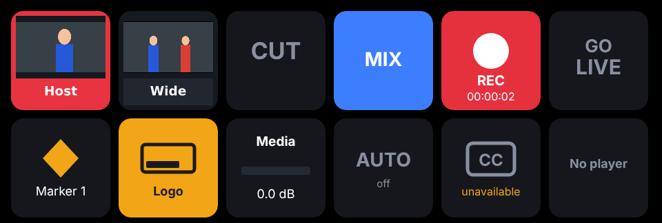

[← The manual](README.md)

# Remote control, Stream Deck, OSC and MIDI

## Remote control, Stream Deck and MIDI

Turn on **More › Control › Phone remote › Remote control**. Open the address it
shows (e.g. `http://192.168.1.20:8790`) on a phone or tablet on the same
network and type the PIN (on Windows, allow Cutaway through the firewall
when asked: see [Install on Windows](install.md#install-on-windows), step 5). The
remote always has one (Cutaway makes a
four-digit PIN if you don't set your own), and a device that guesses five
different wrong PINs in a row waits a minute before it can try again (a
phone or Stream Deck still using an old PIN after you change it just asks
for the new one). If the phone or a Stream Deck key asks for something that
can't be done, the message shows on the laptop too. Talkback, a held pad or
a camera move started from the phone or Stream Deck lets go by itself if the
connection drops or the phone locks.

The remote has four tabs at the bottom, and it remembers the last one you
used on that phone:

- **Scenes:** the program picture, then the same switching buttons as the
  desk. **TAKE** and **CUT** always mean the same thing: the scene in
  preview goes on air, with the transition or straight away (they're dimmed
  while nothing is in preview). Under them, **Preview** turns Preview mode on
  and off, the transition chip (**Mix ▾**) opens the choice of transitions
  (Cut, Mix, Wipe, Push, Dip, Stinger), and **⟲ Back** goes back to the last
  scene. Then the scenes in two columns with their key number and an
  **ON AIR** or **NEXT** tag. Tapping a scene does what the desk's scene
  button does (with Preview on it goes in preview, otherwise it's taken with
  the transition); **holding** one for half a second cuts it straight to
  air. Folded below: Auto switching, captions and **Fade to black**.
- **Sound:** sound pads, Syrinscape, talkback, and each mic or input with ON /
  OFF, its level and a fader (−60 to +12 dB, the same range as `gain`
  commands and MIDI faders).
- **Titles:** graphics, rotations and timers.
- **More:** each stream destination, viewer comments, replay, the rundown,
  macros, media players, PTZ, the teleprompter and the tally-light links.

Along the top, always: the show's name, one status light (**All good**, or
**2 to check**: tap it for the list, which includes stream destinations that
are down and a recording that failed), the recording time left on the drive,
and the **REC** and **LIVE** buttons. LIVE says how it really is: **GOING
LIVE…** while it connects, **LIVE 1 of 2** with each destination's state when
one isn't up. Along the bottom, above the tabs: **Names**, **◆ Marker** and
**✂ Clip**. **◆ ▾** beside the marker lists your quick marker names (set them
once in More › Control › Phone remote → **Quick marker names**; Good, Retake
and Cut here to start with): one tap adds a marker with that name, so you
don't type mid-show. On a short screen (a phone on its side) the bars and
the picture get smaller, and the top scrolls away with the page; a long
status list or pre-show check scrolls inside its box.

Taps you can't take back need a one-second hold (a fill grows across the
button, and letting go sooner only says **Hold to…**): stopping the recording,
going live and ending the stream, fade to black, and turning a mic off.
Starting a recording, turning a mic on and coming back from black are one tap.
Each button sends what it means (start or stop, never "switch over"), so a
screen that's a moment out of date can't stop a recording with a tap. The
rundown's **◀ Previous** (on the More tab) goes to the previous segment;
**⟲ Back** is always the last scene.
When the pre-show check is turned on (More › App › General → **Pre-show
check**), starting from the phone, the Stream Deck, MIDI or OSC runs the check
on the desk first, the same as the Record button; the phone shows what the
check found, with **Start** (or **Start anyway**) and **Cancel** buttons so
you can answer it from across the room (or answer it on the desk), and
whether it started.

The remote keeps updating while the Cutaway window is minimised or hidden.
The phone's screen is allowed to go dark as usual; to keep it on while the
remote is open and showing, turn on **Keep screen on** on the More tab (it
uses more battery). A tally light page always keeps its screen on. If nothing has come from
Cutaway for five seconds (the phone left the Wi-Fi, the laptop went to
sleep), a **Reconnecting to Cutaway…** strip shows at the top and the
buttons dim, so a frozen screen never looks live; Cutaway sends a small sign
of life every two seconds, so a quiet show isn't mistaken for a lost one. If
Cutaway itself stops updating the show (it is stuck, not the Wi-Fi), the
strip says **Cutaway isn't updating**.
Coming back to the page (unlocking the phone, switching back to the browser)
fetches the show and reconnects straight away.

- **Tally lights:** `http://<address>:8790/?tally=2` turns a phone into a
  full-screen tally light for source 2 (red on air, green in preview).
  **More › Control › Phone remote → Tally lights** has a button per source
  that copies its link (with the PIN), and so does the remote's More tab.
- **For scripts:** the same page's **For scripts, Companion and other apps**
  lists these addresses with your own computer's address and PIN in them.
- **Stream Deck:** install the Cutaway plugin (below).
- **Companion / scripts:** every command is a web address:
  `http://<address>:8790/api/action?do=<command>&pin=<PIN>`. In Companion,
  use the Generic HTTP module (or OSC, below).
- **Other endpoints:** `/api/state` (JSON: scenes, tally, recording, live,
  each stream destination, inputs, levels, players, captions, disk, problems,
  the pre-show check while it's open, recent viewer comments), `/api/program.jpg`
  (the program picture), `/api/tally/<n>` (`program`, `preview` or `off`),
  `/api/key/scene/<n>.png` and `/api/key/source/<n>.png` (key pictures with
  tally, `?size=144`).
- **WebSocket:** `ws://<address>:8790/api/ws?pin=<PIN>` pushes the state
  (`{"type":"state","state":{…}}`) whenever it changes (and `{"type":"tick"}`
  after two quiet seconds, so a client can tell it's still connected), and takes commands
  as text (`scene:2`) or JSON (`{"do":"scene:2","id":7}`, answered with
  `{"type":"reply","id":7,"ok":true,…}`).

### Stream Deck

Double-click `streamdeck/Cutaway.streamDeckPlugin` (or press **Install the
Stream Deck plugin…** in More › Control › Stream Deck, which also lists
all 28 of the plugin's keys and what each does; the Mac app carries it
inside). Drag Cutaway actions onto keys, and in any key's settings enter the
address (`127.0.0.1:8790` on the same computer) and the PIN. Needs Stream
Deck 6.5 or later, on macOS or Windows. See [streamdeck/README.md](../../streamdeck/README.md).

*Scene and source keys show live pictures (red on air); record shows its
running time on a dark key with a red dot, an amber edge when something
needs a look and SAVING 40% while a recording is finished; Go Live (pink) says
GOING LIVE… while it connects and "LIVE 1 of 2" while a destination isn't
live, as the phone does; graphics, transitions and captions light up when
on.* A Scene key does what the desk's scene button does unless you set it
to always take, preview or cut; **Preview** and **Back** keys turn Preview
mode on and off and go back to the last scene; a **Marker** key can carry a
name (one of your quick marker names).

### OSC

Turn on **OSC** in More › Control › OSC and MIDI (UDP port 8791). Addresses
follow the commands (the `/cutaway` prefix is optional):

| Address | Does |
|---|---|
| `/cutaway/scene/2` or `/cutaway/scene "Host"` | Take a scene |
| `/cutaway/preview/2`, `/cutaway/take`, `/cutaway/cut` | Preview / take / cut |
| `/cutaway/record 1`, `/cutaway/live 0`, `/cutaway/talkback 1` | On / off (no argument = toggle); a button sending 1 then 0 holds talkback |
| `/cutaway/graphic/1`, `/cutaway/audio/Mic 0` | Graphics, inputs |
| `/cutaway/fader/Mic 0.8` | An input's level from a fader (0…1) |
| `/cutaway/gain/Mic -6` | An input's level in dB |

Set **Send state to** and Cutaway sends `/cutaway/program`, `/preview`,
`/record`, `/live`, `/tally/N`, `/scene/N`, `/graphic/N`, `/audio/N`,
`/level/N` and the clocks as they change (and everything every 5 seconds),
for button feedback. `/live` is on from Go live; `/stream` says how it's
really going, as the phone does (`connecting`, `live`, `trouble` while some
destinations aren't live, `ending` or `off`), with `/stream/live` as "1 of 2".

| Command | Does |
|---|---|
| `scene:2` or `scene:Host` | Take a scene (by number or name) with the current transition |
| `cut:2` | Cut straight to a scene |
| `preview:2` | Put a scene in preview |
| `press:2` | As the desk's scene button: into preview with Preview on, otherwise taken with the transition |
| `preview:on`, `preview:off`, `preview:toggle` | Preview mode on or off |
| `take` / `cut` | Take / cut the preview to program |
| `back` | Back to the last scene: the one on air before this one, with the current transition (again goes forward) |
| `transition:mix` | Choose `cut`, `mix`, `wipe`, `push` or `dip` |
| `record`, `record:on`, `record:off` | Recording (toggle / on / off) |
| `live`, `live:on`, `live:off` | The stream |
| `marker`, `marker:Guest arrives` | Add a marker (optionally named) |
| `auto`, `auto:on`, `auto:off` | Automatic switching |
| `graphic:1`, `graphic:Logo:off` | Show / hide a graphic |
| `mute:Mic`, `unmute:Mic`, `audio:Mic` | An input on / off / toggle |
| `gain:Mic:-6` | Set an input's level in dB |
| `media:Clips:play` | Media player: `play`, `pause`, `toggle`, `restart`, `next`, `previous` |
| `source:2` | A source full screen, straight on air (to preview with Preview on), like Shift+clicking its tile |
| `captions`, `captions:on`, `captions:off` | Captions on screen |
| `transition:stinger` | Use the stinger (set in Scenes › More ▾ › Stinger & fade to black) |
| `pad:1`, `pad:Applause`, `pad:1:stop`, `pads:stop` | Sound pads (press: play, or stop if playing; `play`, `stop`, `release`) |
| `talkback`, `talkback:on`, `talkback:off` | Talkback |
| `syrinscape:2`, `syrinscape:Tavern`, `syrinscape:stop`, `syrinscape:volume:0.8` | Syrinscape buttons (by number or name); `syrinscape:mood:19` and `syrinscape:element:1541818` start any by its number |
| `clip`, `clip:45` | Save the last 30 (or 45) seconds as a clip |
| `timer:Back in:start` | A countdown or stopwatch: `start`, `pause`, `toggle`, `reset`, `stop` |
| `rundown:next`, `rundown:previous`, `rundown:3`, `rundown:Interview`, `rundown:stop` | The rundown |
| `ftb`, `ftb:on`, `ftb:off` | Fade to black and back |
| `replay`, `replay:slow`, `replay:10`, `replay:stop` | Instant replay (the last seconds as set, or 10) |
| `replay:Cam 2`, `replay:quad:slow`, `replay:program` | Replay from one camera, every angle at once, or the program |
| `macro:2`, `macro:Open the show` | Run a macro |
| `wait:2.5` | In macros and cues: wait 2.5 seconds before the next command |
| `ptz:Cam 2:preset:1`, `ptz:2:home`, `ptz:2:left:0.5`, `ptz:2:in`, `ptz:2:stop`, `ptz:2:store:3` | PTZ cameras: presets, home, moves (`left`, `right`, `up`, `down`, `in`, `out`, with a speed) until `stop` |
| `prompter`, `prompter:faster`, `prompter:slower`, `prompter:back`, `prompter:forward`, `prompter:top` | The teleprompter |
| `comment:next`, `comment:hide`, `comment`, `comment:<n>` | Viewer comments on screen (`<n>` is a comment's number from `/api/state`) |
| `precheck:start`, `precheck:cancel` | Answer the pre-show check open on the desk: start (anyway) or cancel |

A number picks by position, unless something is named that number (a scene
called "2"). `#` in front always means the position: `scene:#2` is the
second scene button even if another scene is called "2". The phone remote
and the Stream Deck send these, so a scene named with a number can't be
mistaken for a place. A macro that runs itself is stopped there, with a message.

**When scenes move.** `scene:3` means the third scene button, wherever it
came from: that's what the number keys, Stream Deck scene keys (their
pictures show the scene in that place), the remote, OSC and commands sent
from Companion or scripts do, so they always match the bank. Commands kept
in Cutaway itself are different: when you reorder or delete scenes,
macros, MIDI mappings, your own keys and cues that take a scene by number
are changed to its new number, so they keep taking the same scene. Things
that go by name (the rundown's scenes, "if it drops, cut to", automatic
switching, the vertical version's layouts, `scene:Wide`) are unaffected by
the order, and follow a scene when it's renamed. Back to the last scene
goes by name too. A deleted scene's references are left as they were
(Scenes › Scenes and Edit layout list them before you delete).

Scenes and rundown segments can run commands as **cues** when they start
(Edit layout → Also run…; More › Show tools › Rundown), e.g. a break scene that
starts a Syrinscape mood and a "Back in" countdown.

**MIDI** (macOS and Windows): pick the controller, then **＋ Add a mapping**, press
**Learn** and hit the pad, key or fader. Pads can run any command above
(a "while held" sound pad or `talkback:on` stops when you let go);
faders (CC) can set an input's level. Pads light up for the scene on air, the
one in preview, recording, live, auto, graphics and inputs that are on.
