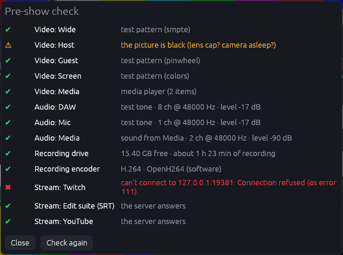

[← The manual](README.md)

# What Cutaway does

Everything Cutaway can do, area by area. For the steps of a first show, see [Getting started](getting-started.md).

## What it does

### Sources

- **Any source, many at once.** Webcams, USB/Thunderbolt capture cards and
  cameras over HDMI capture (if QuickTime Player can see it, Cutaway can), the
  screen, or test patterns. There is no fixed limit; 4K sources are supported.
- **Screen capture: a screen, a window or an app.** In **Sources › Cameras**,
  **＋ Add → Screen, window or app**, then pick it like sharing your screen
  in a video call: your displays drawn as they're arranged, or cards
  with a picture of each open window and app. A window keeps its shape (black
  around it), is found again by its title after a restart, and comes back by
  itself if it's closed and reopened. (An app on Windows is its biggest
  window; on a Mac, every window it has on that screen.)
- **Change the line-up mid-show.** Add, remove or change sources and audio
  inputs while recording or live: only what changed opens or closes, and the
  rest never blinks. Removing one while recording or streaming asks first; its
  own file in that recording ends there (timelines know). One added mid-recording, or
  one that restarts (a camera plugged back in, renamed or set to another
  size), is in the program at once and gets a file of its own straight away,
  named for when it starts (`ISO_04_Cam_2 (from 00-20-14).mp4`) and placed
  right there in the timelines and the Resolve project. (Those files have no
  sound of their own; the mix is in the program and Mix.wav.) Only the
  program's size and frame rate still need recording and streaming stopped.
- **Network sources.** Take a feed from another computer, a phone app or an
  encoder over the network:
  - **RTMP in:** Cutaway runs its own RTMP server (`rtmp-in:1935/key`); point
    OBS, Larix, a hardware encoder or another Cutaway at it.
  - **SRT:** listen for a sender (`srt-in:9000`) or call one
    (`srt://host:port`).
  - **NDI:** any NDI source on the network (`ndi:Name`), once the free NDI
    runtime is installed (see [NDI](install.md#ndi)).
  - Each network source has a fixed latency buffer so its picture and sound
    stay in step with your cameras.
- **Remote guests by link.** Send a guest a link; they open it in their
  browser (computer, tablet or phone), allow the camera and mic, and join —
  no app, no account. Each guest spot is a source and an audio input. They
  hear the show without their own voice (mix-minus, plus talkback) and can
  watch the program. A guest can share their screen too (the whole screen,
  one window or a browser tab), arriving as a source of its own while their
  camera stays on. Signal bars warn you when a guest's connection is
  struggling, before their picture freezes. Cutaway reaches them through a
  free Cloudflare tunnel, so there's no router setup, or through Tailscale
  Funnel for links that stay the same from one show to the next (see
  [Remote guests](guests.md#remote-guests)).
- **Media player.** A source that plays a playlist of video files and still
  images, with sound: intros, stings, holding slides, B-roll. Play, pause,
  next and restart from its tile, the remote or MIDI; optionally restart when
  it goes on air.
- **Devices that come back.** A camera, capture card or interface that's
  unplugged is marked offline and reopened automatically when it returns,
  without touching anything else. Its tile says what's happening: "Connecting"
  while a camera starts, "Reconnecting" for the first 20 seconds after its
  picture stops, and "NO SIGNAL" only once it really isn't there.
- **Auto-framing:** a virtual close-up cut from one wide (ideally 4K)
  camera that follows the people in it — everyone, the closest person, or
  whoever is on the left, in the middle or on the right — and glides to a
  new framing like a camera operator. It's a source like any other: switch
  it, record it, key it.
- **Background removal without a green screen:** cut the people out of any
  source and put them over slides, a background image or another camera.
- **Frame fixes per source:** crop, mirror, brightness, contrast, saturation,
  a **colour LUT** (`.cube`, e.g. a camera's log to Rec.709, with a strength),
  and a **green-screen key** with spill suppression.
- **Phone cameras:** scan a QR code with a phone and it becomes a camera —
  up to 1080p, straight over your Wi-Fi, screen kept on, reconnecting by
  itself (Safari on iPhone, Chrome on Android). See
  [Phone cameras](sources.md#phone-cameras).
- **PTZ cameras:** pan, tilt, zoom and presets for cameras that speak VISCA
  (over IP, TCP or UDP) or NDI, from a joystick in the PTZ panel, the
  phone remote, the Stream Deck, MIDI and OSC. In the panel, **Save here ▾**
  keeps the current shot as a preset, and **⌂ Home** sits on its own row,
  away from Zoom out: while that camera is on air it takes a one-second
  hold, and a virtual camera's **↶ Undo Home** glides back to the shot it had.
- **Close-ups you aim (virtual PTZ):** a camera operator inside one wide (ideally 4K) camera:
  pan, tilt and zoom around its picture, with presets it glides to. Frame
  the presets in Sources › Close-ups & PTZ by dragging boxes on the wide picture; it starts
  on preset 1.
- **Split a camera into close-ups:** **Sources › Close-ups & PTZ** walks you
  through it: pick the camera and **＋ 2 close-ups** or **＋ 3 close-ups**, drag
  each box onto a person, then **Apply (restarts cameras)** on the bar at the
  bottom. (**⋯** on a camera's tile, right-click
  it, or **Split…** under the list in Sources › Cameras do the same.) Each
  person gets a virtual PTZ camera of their own ("Cam 1 left", "Cam 1
  right"…), with a box on the wide picture to drag onto them and a name
  title to fill in. Each records to its own file, ready for the edit. Each
  close-up is sized to the part of the picture it shows (half a 4K camera
  is 1080p), so it stays sharp and is cheap to cut out. Applying also adds
  a scene "Cam 1: both" (or "all three") with the close-ups side by side,
  unless a scene of that name is already there. Split a camera that has
  close-ups already and the button says **Replace the close-ups**: the new
  ones take their place (and their names), rather than adding "Cam 1 left
  2". A close-up set far bigger than the picture it really holds (a 4K file
  of a part of a 1080p camera) gets a ⚠ in Sources, and a note when you
  start recording.
- **Lists work the same everywhere:** video sources, audio inputs, graphics,
  stream destinations, rundown segments and macros all have the same buttons
  under the list: **＋ Add**, **Duplicate**, **Remove**, **↑** and **↓**
  (then any of their own, like **Split…**). In Sources › Cameras, **＋ Add**
  is a small menu: **Camera or capture card** (the next one not in use yet),
  **Screen, window or app**, **Test picture** or **Media player**.
- **See it as you change it:** in **Sources** each source shows its picture
  above its settings (the multiview's own, so nothing is opened twice). Crop,
  mirror and colour show as you change them; a source you've only just added,
  or changed in a way that restarts it, shows once you press **Apply
  (restarts cameras)** on the bar at the bottom.
- **The Sources area** has tabs: **Cameras** (every source, with **If it drops
  while on air** first), **Close-ups & PTZ** (close-ups cut from a camera,
  auto-framing and PTZ cameras), **People & names**, and under **More ▾**
  **Guests**, **Network & phone feeds** (SRT, RTMP, NDI, phone cameras) and
  **Media & playlists** (media players, with ⏮ ⏯ ⏭ ⟲ for the one picked). It
  remembers the source you had picked, by name, on this computer.

### Recording

- **One file per source (ISO recording)** plus a `Program` file with the
  switched show. Every file starts at the same instant, has a constant frame
  rate, and carries the program audio, so multicam sync in an editor is
  instant.
- **Codecs:** H.264 or H.265 in MP4/MOV, or **Apple ProRes** 422 Proxy, LT,
  422 or HQ (in MOV) on Macs whose media engine encodes it.
- **Proxies:** optional small H.264 copies of every video file in a `Proxies`
  folder, for smooth editing on a laptop.
- **Backup drive:** optionally write a second copy of every file to another
  drive as it records. If the backup drive fails, the main recording carries
  on.
- **Timecode:** every file is stamped with time-of-day timecode (and the WAVs
  with Broadcast WAV timestamps), so editors line them up automatically.
- **Markers:** press `M` (or the Marker button, the remote, MIDI) to mark a
  moment. Markers become chapters in the files, markers on the exported
  timelines, and a ready-to-paste YouTube chapter list.
- **Every input on its own track:** optionally, the Program file carries
  each audio input as its own (disabled) track after the mix, so an editor
  can re-balance the show without the WAVs.
- **No sleeping mid-show:** while recording or live, the computer and its
  screens stay awake, even when you only switch from a Stream Deck or the
  phone remote and nobody touches the laptop.
- **Crash rescue:** the video files are written so that if Cutaway closes
  mid-recording everything up to about the last second is still there, and
  every file is put on the disk every few seconds as it records, so a power
  cut loses only the last few seconds; next
  time Cutaway opens it repairs the recording (the proxies too, and the files
  keep their timecode). Cutaway also keeps a small note in the recording folder
  as you record (`.take-journal.jsonl`, hidden): the switches, the markers
  and the files. So a rescued recording gets back what a normal Stop saves: the
  switch log, the editor timelines with your live edit, the Resolve take
  file, the markers and the chapters. Its Take.txt says it was rescued,
  with its date and length. After a normal Stop the note is removed. A
  file that hit a problem while recording (a drive hiccup, the disk
  filling at the very end) is repaired when the recording stops, so it still
  plays; the recording card says which file and why.
- **FAT32 drives:** starting a recording on a drive formatted as FAT32 (common on
  older USB sticks and SD cards) warns straight away: no file there can be
  bigger than 4 GB, so a long take would stop. Use exFAT, APFS or NTFS.
- **No accidental quits:** closing the window (or Cmd+Q, Alt+F4) while
  recording or live, or while a recording is still saving, the podcast copy is
  being made or an upload is running, asks first. Quitting anyway finishes
  and saves the recording and ends the broadcast; a podcast copy being made
  stops and isn't saved (Mix.wav is kept). **Restart to update** waits
  for all of these too.
- **Desk changes are kept:** fader levels, inputs on or off, the
  transition, the right-hand column and your scene edits are saved a few
  seconds after you make them, so a crash doesn't lose them.
- **Instant clips:** press **✂ Clip** (or `K`, a Stream Deck key, the
  remote) to save the last 30 seconds (your choice) of the program as its
  own file in the recording's `Clips` folder, while the recording carries on —
  for social media, a highlight or a blooper reel.
- **Audio sessions:** every recording also comes with a **REAPER** session and a
  **DAWproject** (opens in **Fender Studio Pro**/Studio One, Bitwig and
  Cubase) with every WAV on its own track, lined up, with the markers.
- **DaVinci Resolve project in two clicks:** press **Open in Resolve** on a
  recording, then in Resolve **Workspace → Scripts → Cutaway - Build project from
  a take**: a new project at the recording's frame rate and size, with bins for
  the cameras and the audio, proxies linked, and a timeline with your live
  edit on V1, every camera (and the program) full length on its own track
  above it, in sync, and the mix underneath. When it's done (or if Resolve
  couldn't do something) a small Cutaway box in Resolve says what happened.
  Recorded the show in two parts (a break in the middle)? With the first
  recording's project still open in Resolve, the script asks **Add to this
  project** or **New project**: adding puts the second recording in a bin of its
  own in the same project, with its own live-edit timeline. It asks only
  when the open project is the same show on the same day.
- **Saving files** after you stop shows what it's finishing (each video, the
  sound, the timeline) and how far along it is, on the Record button.
- **Recording saved:** once it's done, a card under the Record button says how
  long the recording is, how big (the files it recorded), how many markers it has
  (click them to see them in **Record & stream › Recordings**), and either ✓ All files
  saved or ⚠ what went wrong (dropped or repeated frames, a file that failed,
  a backup copy that didn't finish). Its buttons: **Open in Resolve** (see
  [Editing your recordings](after-the-show.md#editing-your-recordings)), **Show in Finder** (Explorer on
  Windows) and **Upload** (when uploads are set up). When all went well the
  card goes by itself after 20 seconds (hovering over it keeps it; after
  **Open in Resolve** it stays 90 seconds, so the one step left in Resolve is still there), so it
  doesn't sit over the panels between takes; one with a ⚠ stays until you
  close it. ✕ hides it any time (the recording stays first in Record & stream › Recordings),
  and the next recording hides it too.
  The time left on the drive stays in view at the top right.
- **Record & stream › Recordings:** the last ten takes, newest first, from the recording
  folder and the folders you recorded to before (and the backup drive), so
  last week's recordings stay when you record somewhere else; a recording from
  another folder says which. For each: date, length, size and file count
  (the same figures as the card), how many markers, and ⚠ whatever Take.txt notes went wrong. Each recording's
  markers are listed under it (the newest take's open), so they're still
  there after you stop. A recording rescued after a crash is listed too, marked
  **Recovered**. Each has the card's buttons: Open in Resolve, Finder/Explorer
  and Upload.
- **The REC clock** counts from the recording's first frame, the same moment the
  files, the markers and the recording's length count from.

A recording looks like this:

```
Take_2026-10-16_19-30-02/
  Program.mp4                        the switched show (+ program audio)
  Program_Clean.mp4                  the show without graphics (if turned on)
  Program_Vertical.mp4               the 9:16 version (if turned on)
  ISO_01_Wide.mp4                    each recorded source, full quality (+ program audio),
  ISO_02_Host.mp4                      numbered 01, 02, 03… with no gaps
  ISO_03_Guest.mp4
  Audio_01_DAW.wav                   every channel captured from the interface
  Mix.wav                            the recording mix (if turned on, or for the podcast)
  Take_… (Podcast).m4a               the levelled episode with chapters (if turned on)
  Transcript.txt, Captions.srt/.vtt  what was said (with captions on)
  Proxies/                           small copies (if turned on)
  Clips/Clip 01 (12m30s).mp4         instant clips
  Guests/Guest_1_backup.webm         a guest's own recording (if turned on)
  Take_2026-10-16_19-30-02.fcpxml    the live edit for Final Cut Pro / Resolve
  Take_2026-10-16_19-30-02.rpp       REAPER session (every WAV on a track)
  Take_2026-10-16_19-30-02.dawproject  Fender Studio Pro, Bitwig, Cubase
  Take_… (Resolve).lua               what the Resolve script builds the project from (its cut list)
  Take_2026-10-16_19-30-02 (Premiere).xml
  Chapters.txt                       markers as a YouTube chapter list
  Switches.csv                       timecode, scene, transition for every switch
  Graphics on air.csv                each graphic shown: how often, how long, when
  Take.txt                           devices, encoders, settings, markers, files
```

Recordings start with the **Take name** from Record & stream › Quality and files. Leave it as
"Take" and, once you've chosen a show, recordings are named after the show instead
(`My_Show_2026-10-16_19-30-02`), and so is the Resolve project the script makes.

### Switching and graphics

- **Scenes.** Preset scenes (each source full screen, side by side,
  picture-in-picture, grid) plus your own: drag and resize frames live, then
  save them. Start a new scene blank or from one of those layouts
  (**＋ New scene** in Show › Edit layout or Scenes › Scenes), and put the
  scene buttons in the order you want (drag them in Edit layout, or ↑ ↓ in
  Scenes › Scenes): keys 1–9 take the first nine, and 0 the tenth. The Scenes pages save as
  you go, with Undo.
- **Fill, crop and zoom per scene.** Each frame in a scene can show the whole
  picture (fit) or fill the frame, cropped to its shape, so a camera in a tall
  half-screen box has no black bars. Zoom in (scroll over the frame, up to
  4×) and move the picture inside its frame (**✥ Move picture**, or
  Option/Alt-drag), so the same
  camera can be a close-up in one scene and wide in another. Mixes glide the
  crop along with the frame.
- **Transitions:** Cut, Mix (shared frames glide to their new places while
  others fade), Wipe, Push and Dip to a colour, with a direction and length.
  CUT / MIX / ⋯ beside the scenes and **Scenes › Switching** are the same
  setting: change either and the other shows it at once.
- **Stinger transitions:** a short video (a logo sweep, a burst of colour)
  plays over the program and the scenes change underneath at its cut point,
  with its sound. Use a stinger with a track matte (most stinger packs
  include one — it works with any H.264 file), one where black is
  see-through, or a solid one.
- **Preview/program:** optionally pick the next scene in a preview monitor
  first, then **Take** (Space) or **Cut** (Enter), like a hardware switcher.
  **Edit layout** then changes the scene in preview, never the one on air,
  so moving a picture-in-picture doesn't show in the recording. With Preview
  off, Edit layout shows a red **ON AIR** label, because every change is
  seen at once, and an **Edit in preview** button.
- **Automatic switching:** follows whoever is talking, from each person's mic
  channel, with a minimum shot length, a wide shot for crosstalk or long
  shots, and a pause after you switch by hand.
- **Frame styling:** rounded corners, borders and drop shadows on framed
  sources (they disappear smoothly as a frame grows to full screen). They're
  in Scenes › More ▾ › Program picture and apply as you change them; the
  program's size, frame rate and background there wait for **Apply
  (restarts cameras)**.
- **Graphics:** logos/watermarks (PNG with transparency) and name titles
  (lower thirds) above every scene, each with its own button. Each comes on
  its own way: a fade, a slide in from the nearer side, a wipe from left to
  right, a gentle rise, or a pop (**Comes on** in its settings, with how long
  it takes), and leaves the same way back. Title text can be changed live
  between guests.
- **Names that follow people:** give each source the name and role of
  whoever is in it (**Sources › People & names**, the one place names are
  changed, which also offers **＋ Make a name title** when there's none; a guest spot
  uses the name the guest types), and make a name title: **＋ Make a name
  title** on **Graphics › Titles & overlays** (the first thing it offers
  while a show has no graphics yet, with one line saying how your name
  titles stand once it has one), or **＋ Name title** there, or the same
  button in the Graphics panel on the desk (the panel is always there;
  **Fixed title** is for typed text). It names whoever fills the program, changing at each
  cut, and can come on by itself for a few seconds when someone new is on
  air (not again for the same person for 10 minutes, or as you set). Its
  button keeps it on for as long as you like, and says whose name it shows:
  amber while it's on screen, an amber edge while it's switched on but
  nobody with a name is on air. For two people on one camera,
  make a close-up of each (a close-up that follows the person on
  the left or right, or one you aim) and name each close-up. When two or
  three frames on air are the same size (the two close-ups side by side),
  the title names them all, left to right: **Maya Chen & Sam Lee**, with
  their roles the same way (or the one role they share). With more people
  than that it names nobody rather than guess.
- **Graphics taking turns:** a group of graphics (sponsors, your social
  handles, a "subscribe" reminder) where every few minutes the next one
  comes on for as long as you set, then goes off. It starts and stops by
  itself when you go live (or record), or from its **⟳** button, a key, the
  remote, the Stream Deck or MIDI (`rotation:Sponsors`). Set it up in
  **Graphics › More ▾ › Taking turns**, where **Start now** / **Stop**
  start or stop it straight away.
- **Time on screen:** hover a graphic's button to see how many times and how
  long it's been on since you went live, and every recording's folder gets
  **Graphics on air.csv** (each graphic, how often, for how long, and when),
  handy for sponsor reports.
- **Web page overlays:** any web page or HTML file over the picture, see-through
  wherever the page has no background, like a browser source in OBS:
  StreamElements or Streamlabs alerts and chat boxes, scoreboards, animated
  graphics made for the web.
- **Clocks and countdowns:** clock graphics show the time of day, a
  countdown to a time ("Starting in 4:59"), a countdown or stopwatch you
  start from a button, key or cue, or the time left in the rundown segment
  (red when it runs over). They're in **Graphics › More ▾ › Clocks &
  timers**, where each timer has **▶ Start** and **⟲** too. A countdown to a
  time that has gone by counts to the same time the next day, so one to
  00:30 set at 23:50 shows 40:00 (for an hour after its time it rests at
  0:00). The second screen can also show the time and the segment clock
  just for the presenters.
- **One clock format:** 24-hour or 12-hour is one setting for the whole
  show: the top bar's clock, clock graphics, the second screen and
  scheduled times all follow it. Choose under the status light, at the top
  of **Graphics › More ▾ › Clocks & timers** or in **More › App › General**. (A show from before this keeps the format its on-air clock
  had.)
- **The Graphics area:** **Titles & overlays** lists every graphic in the
  order of their Alt (⌥) keys, with a preview of the one you pick beside
  **Show** / **Take off**; **More ▾** has **Clocks & timers**, **Captions**,
  **Taking turns** and **Tickers & web overlays**. Changes save as you make
  them, with Undo, and the graphic you picked is still picked when you come
  back.
- **Rundown:** the show's running order — each segment with a planned
  length, a scene and cues (graphics, pads, Syrinscape moods, timers) — that
  you step through with **Next** (`N`), the Stream Deck or the remote. It
  shows the time left in each segment, what's next, and how far over or
  under the show is running, and marks each segment in the recording as a
  chapter.
- **Fade to black:** hold **Fade to black** for a second and it fades the
  picture and the sound out (a click brings them back in) over a time you
  choose; the recording and stream carry on.
- **Instant replay:** **⟲ Replay** plays the last few seconds of the program
  again over it, in slow motion if you like, with a "REPLAY" label, then
  fades back to live (while recording). It can show the moment from any
  camera instead, or up to four cameras at once.
- **Macros:** a button that runs several commands in order, with waits
  between (e.g. take a scene, start a pad, show a title, wait 5 seconds,
  hide it).
- **Scrolling ticker:** a news-style strip of text along the bottom, with a
  label, at the speed you set; change its text live.
- **Viewer comments:** read your Twitch and/or YouTube live chat in Cutaway
  and put a comment on screen with one click (or the next one with a key).
- **Teleprompter:** your script (or the rundown's notes) on a second screen
  or any tablet's browser, mirrored for a glass if needed, rolled and paused
  from Cutaway, the Stream Deck, the remote or a keyboard on the tablet.
- **Tally:** red for on air, green for preview, in the multiview, on the
  phone remote and on MIDI pads. Red means on air and nothing else: the
  REC button is a dark pill with a pulsing red dot, LIVE is pink, and TAKE
  (blue) and FTB (amber while the program is black) aren't red, so in a
  dim room you can tell recording, on air and live apart at a glance.

### Audio

- **DAW audio.** Each audio input is recorded to WAV (multichannel, or one mono
  file per channel). You pick which two channels feed the mix. Interfaces with
  their own clock are kept locked to the video for hours (drift correction).
- **Sound › Mixer** lists every input with its meter, its fader (−60 to
  +12 dB, the same range as the desk, MIDI and the `gain` command) and ON,
  above the limiter, stream loudness, automatic mic mixing and ducking.
  **Set up ›** on a row opens that input in **Sound › Inputs**.
- **One meter per input:** the level an input shows is the same everywhere:
  its strip on the desk, Sound › Mixer and Sound › Inputs, the phone, OSC
  `/cutaway/level`, the pre-show check and the first-show guide all read the
  meter after voice processing and before the fader.
- **Sound › Inputs:** each input has a live level bar (in the list and
  beside its name), so you can see a mic is alive without leaving the page;
  an input not applied yet says "Apply (below) to hear it". Its level, ON,
  where it's heard, ducking, auto-mix, recording and voice processing save
  as you change them; a new input, a new device, channels, name or delay
  (which restart the input) wait for **Apply (restarts inputs)** on the bar
  at the bottom. The page comes back to the input you had picked. **↑ / ↓**
  move an input (the order of the strips in the mixer;
  scenes, auto-mix, ducking and talkback follow an input by name, so they
  carry on; anything that says "input 2" by number, like a remote or MIDI
  button, now means whichever is second) and **Duplicate** copies one under a
  new name.
- **Voice processing** per input: high-pass filter, **noise reduction**
  (RNNoise: fans, hum and room noise turned down, voices kept), noise gate,
  three-band EQ, compressor and de-esser, with a gain-reduction meter on the
  strip.
- **Two mixes:** the recording mix and the stream mix. Each input can go to
  both or just one (e.g. a talkback mic that's recorded but never streamed).
- **Loudness:** LUFS meters (momentary, short-term and integrated) for both
  mixes (integrated, "I", counts from the start of each recording, or from going
  live for the stream, and shows — until then), a safety limiter, and optional **stream levelling** that slowly
  brings the stream to −14 LUFS without pumping.
- **Scene audio:** scenes can turn inputs on or off when they're taken (a
  break scene that mutes the mics and brings up the music), in sync with the
  picture (Edit layout → Audio).
- **Headphones:** listen to either mix, or solo any input, on any output
  device, in sync with the program picture.
- **More outputs and mix-minus:** feed presenters' headphones, or a caller
  on a phone hybrid or video call a mix with their own voice left out, on
  any output channels.
- **Talkback:** hold **TALK** (or `B`, or a Stream Deck key) and your mic
  goes to the presenters' headphones and the guests — never the recording or
  stream — with the rest dipped while you talk. Headphones, talkback and
  more outputs are set in **Sound › More ▾ › Headphones & talkback**, which
  shows the talkback key as it's set now.
- **Automatic mic mixing:** for panels and round tables. The mics you tick
  share one level, the way broadcast automixers do: whoever is talking is
  up and the others drop away (up to 30 dB), so room noise, echo and
  breathing don't pile up, and two people talking at once share it. Nothing
  is ever switched off, so the start of a word is never lost. Each mic's own
  WAV stays untouched. **Sound › Mixer → Automatic mic
  mixing**; the strip shows **↓12** while a mic is turned down.
- **Auto-ducking:** music, pads and ambience marked to duck dip smoothly
  under the voices and come back up after a pause (off until you turn it on
  in Sound › Mixer).
- **Sound pads:** jingles, stings, applause and music beds on buttons,
  F1–F12, the Stream Deck, MIDI pads and the remote: play once, loop, or
  play while held, each with its level and fade. They play through their
  own input strip, so they're recorded and can duck.
- **Syrinscape:** start your Syrinscape Online moods and sounds from
  Cutaway's sound panel, scenes, the rundown, the Stream Deck and MIDI, or
  with ▶ beside each button in **Sound › More ▾ › Syrinscape**, which also
  has Syrinscape's volume. Its
  sound comes in through a virtual cable or Cutaway's **Sound from an app**
  input (captures one app's audio, on Mac and Windows).
- **Automatic lip sync:** clap once where every camera can see it; Cutaway
  finds the clap in every picture and every input and sets each delay (or
  set the delays by hand).

### Outputs

- **Live streaming to many places at once:** YouTube, Twitch, Facebook, Kick,
  any RTMP/RTMPS server, or SRT. The program is encoded once and sent to every
  destination. A destination that drops reconnects on its own; the others and
  your recordings carry on untouched.
- **Adaptive bitrate:** when a connection can't keep up, the stream's
  bitrate eases off until it can, and comes back once it's clear.
- **Scheduled streams:** set the next show up ahead (title, description,
  picture, start time) as a YouTube event you can share before you go live,
  and Cutaway can go live by itself at the start time. See
  [Scheduling a stream](running-a-show.md#scheduling-a-stream).
- **Vertical streams:** send the 9:16 version to YouTube Shorts, TikTok or
  anywhere else, while the other destinations get the program.
- **NDI output:** the program (with its sound), and optionally every source,
  as NDI on your network for other computers, OBS, vMix or recorders.
- **Second screen:** the program, the multiview or the teleprompter, full
  screen on a projector, TV or confidence monitor. Pick the screen from a
  picture of your displays (or leave it on Automatic: any screen but
  Cutaway's). It never fills the screen Cutaway is on by itself, and Esc
  always gets you out: once to leave full screen, twice to close it.
  **Record & stream › Screens & webcam** says what it's showing, with **Full screen**
  and **Close** buttons (and **Show the program there** while it's off).
- **Live captions:** speech recognised on the Mac (nothing leaves it),
  shown on the stream (and optionally burned into the recording), from the
  mix or any one input.
- **Virtual webcam:** the program as a "Cutaway" camera in Zoom, Teams, Meet
  and others. On Windows 11 now; on the Mac it's coming in a later version
  (it isn't in the Mac download yet, see [Virtual camera](install.md#virtual-camera)).

### Control

- **Keyboard** shortcuts for everything you do during a show. Move any of
  them to another key or turn one off, and add your own keys for any
  command (a scene, a graphic, a pad, a macro, a camera move) in
  **More › Control › Shortcuts**. A key you pick wins over a built-in
  one (the built-in's row then shows its key struck through, "taken by your
  own shortcut"), mistakes like a key given two jobs are flagged on the row
  they belong to as you go. On a Mac, Control isn't used for shortcuts (⌘, ⇧ and ⌥ are),
  and a typed Ctrl+ key means ⌘;
  **Print a cheat sheet** opens a page of every key to keep by the keyboard.
- **Undo and redo** (Cmd/Ctrl+Z, Cmd/Ctrl+Shift+Z, or the buttons in Edit
  layout; on Windows, Ctrl+Y redoes too) for what you build: moving, resizing, filling and zooming frames,
  adding, renaming, duplicating and deleting scenes, a title's text, and
  changes made on the settings pages or by switching shows. The show itself (taking
  scenes, recording, going live) is never undone. While recording or live,
  an undo that would take out or restart sources, or switch shows, says so
  and waits until you've stopped.
- **Phone and tablet remote:** a web page served by Cutaway, on any device on
  the same network, with a PIN, laid out for one hand: **Scenes | Sound |
  Titles | More** tabs at the bottom, record and live at the top. Program
  picture, scenes, take/cut, record, live (with each destination's state),
  markers, clips, replay, fade to black, graphics, macros, PTZ presets and
  moves, the teleprompter, viewer comments (read them before one goes on
  air), timers, the rundown, sound pads, mics with faders and the media
  player, plus **tally pages** for phones mounted on cameras and a **prompter
  page** for a tablet. **More › Control**
  shows a QR code for the remote's address with the PIN in it: scan it with
  the phone's camera and the remote opens already signed in.
- **Stream Deck plugin:** keys with live pictures of every scene and source,
  red and green tally, take/cut, transitions, record and go live (hold to
  confirm), markers, graphics, audio inputs with level meters (and Stream
  Deck+ dials for levels), auto-switching, captions, media players, sound
  pads (with their progress), Syrinscape, talkback, instant clips, timers,
  the rundown (with the time left), remote guests, fade to black, instant
  replay, macros, PTZ presets and moves, the teleprompter and viewer
  comments. As on the desk, fading to black and turning a mic off while
  you're recording or live take a one-second hold.
- **Show-control software:** OSC from QLab, Bitfocus Companion, TouchOSC or
  a lighting desk, with state sent back; a WebSocket API that pushes every
  change; and every action is also a plain web address.
- **MIDI controllers:** map pads, keys and faders with Learn; pads light up to
  show what's on air.
- **Show profiles:** save complete setups (sources, scenes, audio, graphics,
  streaming) per production and switch between them from the show's name at
  the top of the rail. If
  the setup you're on isn't a show yet, switching saves it as "My setup"
  first, so nothing is lost. Rename a show in place, and deleting or
  replacing one asks first. Recordings are named after the show you're on (unless
  you've given them a Take name of your own). The interface size and the
  update choices belong to this computer, not the show: switching shows,
  importing settings or starting over leaves them as they are.
- **Pre-show check:** one button checks every source for a picture, every
  input for sound, the disk, and that every stream server answers. It also
  starts every encoder the show needs at the same time (program, each
  recorded source, the stream), so a graphics card that runs out of encoders
  shows up here, not as an empty file after the show. It warns when only the
  software encoder is there for more than one 1080p file. It can run
  automatically before recording or going live.


