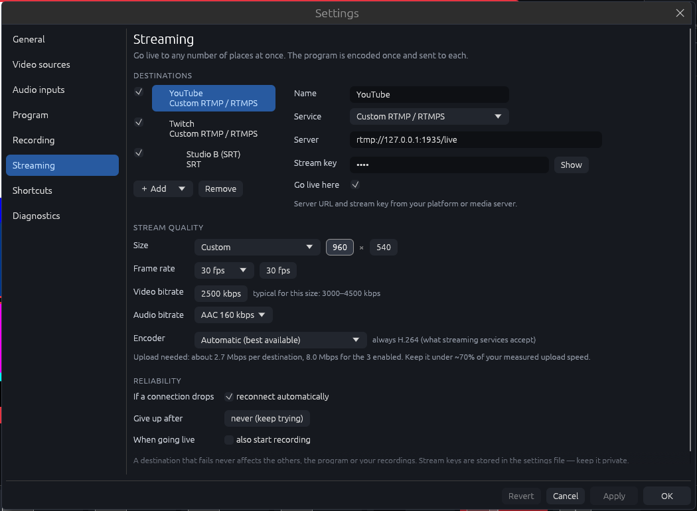

[← The manual](README.md)

# Running a show and going live

## Running a show

| Action | How |
|---|---|
| Take scene 1–10 | Number keys 1–9, and 0 for the tenth, or click the scene button (with Preview on, the keys put it in preview) |
| Scene buttons | Along the bottom, every one in view. Each shows its key number (large), its name, **ON AIR** or **NEXT** (in preview), ♪ when it changes the sound and ⚠ when a source in it has no signal; a long name ends in "…" and shows in full when you hover. With room, each has a live picture of its scene (its sources where its frames are); in a narrower window (a 13" laptop) they become two rows of smaller buttons without pictures, so up to 12 scenes always fit. A bank longer than that scrolls sideways, and the edge says how many more (**+3 ›**: click it). In a window at least 1000 pixels tall they keep their pictures in two rows |
| Cut straight to a scene | Shift + number (Shift+0 for the tenth), or Shift + click |
| Back to the last scene | **⟲ Back** under the transitions, `Backspace` or the `back` command: the scene on air before this one goes back on air with the current transition and its cues (in Preview mode too, without passing through preview). Press it again to go back the other way |
| Put a source full screen | With Preview off, click its tile in the multiview to pick it (a blue edge), then **Put on air** on the tile: so clicking a tile to look closer never switches the show (Put on air ignores clicks for the first moment after you pick the tile, so a double-click can't put it on air). Shift+click a tile cuts to it at once. With Preview on, a click puts it in preview. Each tile shows the source's name and who's in it |
| Preview, then take | Turn on **Preview**; scene keys then load the preview. Space = Take (with the transition), Enter = Cut |
| Transition | **CUT** or **MIX** beside the scenes, with the length (it's greyed for Cut and Stinger, where it does nothing: a stinger lasts as long as its video). Wipe, Push, Dip and Stinger are under **⋯** (which then reads WIPE ▾ and so on). `T` toggles between Cut and the last transition |
| Automatic switching | **AUTO** or `A`. Until it has rules (Scenes › More ▾ › Auto-switching) AUTO is greyed, and a click says so with a **Set up rules ›** link |
| Captions on screen | **CC** or `C` |
| Who an auto-framed source follows | **⋯** on its tile (or right-click it): follow and shot size |
| Marker | `M`, or **◆ Marker** beside REC while recording (greyed out between takes, so REC never moves) |
| Named marker | `Shift+M` while recording, or **▾ › Named marker…** beside ◆: the marker goes in at that moment and a small box under **◆ Marker** asks for its name (typing doesn't move it). Enter names it; Esc keeps "Marker 3"; clicking elsewhere keeps what you typed. It isn't a dialog: scene buttons, tiles and TAKE still work with the mouse while it's open (keys type into the box) |
| This recording's markers | **▾** beside **◆ Marker**: each marker's time, name and the scene on air. Change a name there, or ✕ to take one out, until the recording stops (clips show with ✂ and stay as they are) |
| Save a clip | `K`, or **✂ Clip** beside REC while recording (the last 30 seconds, or as set); the status light's panel has **✂ Clip the last 10 / 30 / 60 s** |
| Instant replay | **⋯** beside CUT / MIX › **⟲ Replay**, or under the status light, while recording: Slow, from the program, one camera or every angle, and the last 5 / 10 / 20 / 30 s |
| Fade to black | Hold **Fade to black** (at the end of the transitions) for a second: a fill grows across it, and a quick click does nothing but say so, so a slip off the transitions can't black out the show. It flashes while the program is black, and reads **Fade up**: one click brings it back |
| Macros, PTZ, teleprompter, comments | Their panels on the right, the Stream Deck, the remote, MIDI or OSC. Set them up in **More › Show tools** |
| Teleprompter page keys | On the prompter page on a computer: Space rolls or pauses, ← → jump a paragraph, ↑ ↓ change the speed, Home goes to the top (the bar under the script says so) |
| Sound pads 1–12 | F1–F12, or the pad buttons in the sound panel (hold for "while held" pads). On a MacBook the F-keys change brightness and volume unless you hold **Fn** with them, or turn on "Use F1, F2, etc. keys as standard function keys" in System Settings › Keyboard › Keyboard Shortcuts › Function Keys; the Shortcuts page and the cheat sheet say so on a Mac |
| Talkback | Hold `B`, or hold **TALK** in the sound panel |
| Next rundown segment | `N` (Shift+N goes back), or **Next ▶** in the rundown panel |
| Timers | **▶ / ⏸** and **⟲** beside a countdown or stopwatch's graphic button: start, pause, back to the start (right-click it for Stop and reset too) |
| Graphics 1–10 | Alt/Option + number (0 for the tenth), or the graphic buttons; ✎ edits a title's text live |
| Media player | ⟲ ⏯ ⏭ on its tile; **⋯** (or right-click) for the playlist |
| Record / stop | ⌘R, or **● Record** at the top right (grey until you record: red means recording or on air). While recording, the **REC** pill turns solid red, with a pulsing dot, and shows the time with **hold to stop** under it: hold it for a second to stop (a dark fill grows across it; a quick click does nothing but light up the hint). A red **● REC 00:12:41** chip on the program picture says it too, where your eyes are. ⌘R asks "Stop recording?" first, so a stray click or key can't split the recording |
| Go live / end stream | **◉ Go live** at the top right, once there's somewhere to stream to (set that up in **Record & stream › Streaming**). It says **Going live…** until a destination is really on air, and the **LIVE** time counts from then, the same on the desk, the phone and OSC. It has no key unless you give it one in More › Control › Shortcuts, so a stray key can't start or end a broadcast (a key gets the same checks and "are you sure?" as the button) |
| Put scenes in order | In **Edit layout**, drag a scene button along the bank (a bar shows where it goes). Only in Edit layout, so a slip during the show can't move one. Or ↑ ↓ in **Scenes › Scenes**, which also renames, duplicates, deletes (it asks first, and says what uses the scene) and starts new scenes. Changes there save as you make them (↶ Undo at the bottom, or ⌘Z); **Edit its layout ›** opens the picked scene in Edit layout (in preview with Preview on) |
| New scene | **＋ New scene** in Edit layout (or Scenes › Scenes): **Blank**, or from a layout (a source full screen, side by side, picture in picture, grid). It goes at the end of the bank, so no other scene's number changes. With Preview on it goes in preview to edit; otherwise take it to edit it |
| Edit layout | `E`, or the **Edit layout** tab beside **Switch** at the top of Show. With **Preview** on you edit the scene in preview (click a scene to pick it; the one on air goes there if preview is empty): the program, and so the recording and stream, stays exactly as it is until you **Take** or **Cut** it. With Preview off you edit the scene on air, and a red **ON AIR** label says so, with **Edit in preview** to turn Preview on; but while you're recording or live, opening Edit layout (`E` or the tab) turns Preview on for you and says so, so a stray `E` and a scroll can't change the picture on air. **↶ Undo** and **↷ Redo** sit at the top. **Picture** (in the selected frame): **Fit/Fill**, **Zoom**, **✥ Move picture** (drag inside a frame to move its picture; Option/Alt-drag does the same) and **Reset**. **Scene**: its name, **Add source**, **Audio** (inputs it turns on or off), **Also run…** (commands it runs when it's taken: a title, a pad, a mood), **＋ New scene**, **Duplicate**, **Delete…** (it asks first, says what uses the scene, and Undo brings it back). Under the bar, once you click a frame, **Frame**: **Remove**, **To front**, **Full frame**, then a line that says what the mouse does: drag frames, drag the corner to resize (Shift keeps shape), scroll to zoom, double-click to fit or fill. **Unsaved** shows until the scenes are written to disk: **Save scenes**, or a few seconds after **Done**. **Done** or Esc goes back to Switch |
| Audio strip | Always at the bottom of the column, under a fixed AUDIO heading, with room kept for it. Fader beside each meter = level, −60 to +12 dB (double-click resets), **ON** = in the mixes (click to turn it off; while you're recording or live, hold it for a second instead, so a slip can't cut a mic mid-show; turning one back on is always a click), 🎧 = solo in the headphones. Beside them, **REC MIX** (the recording) and, once there's somewhere to stream to (Record & stream › Streaming), **STREAM**, each with its loudness |
| Fold or move a panel on the right | Click the ▾ or the name in its heading to fold it down to one line, again to open it (the rest of the heading does nothing, so a click a little high of a button can't fold the panel away). Drag a heading by its ⠿ dots onto another panel's heading to move it above that one (not while you're recording or live, so the column can't rearrange itself mid-show), or use **⋯ › Arrange panels…** at the top of the column (↑ ↓, Open, and **Reset order, folds and width**). Hovering a heading shows **Set up ›** for that panel; ⋯ lists them all. When panels go on below what fits, a line at the bottom says which (click it to scroll). Each show remembers its own |
| Widen the column on the right | Drag its left edge (the three dots), up to about 60% of the window. Each show remembers its width |
| Second screen | **Second screen** under the status light (set it up in Record & stream › More ▾ › Screens & webcam, which also has Full screen and Close buttons). On that window: double-click or `F` for full screen, Esc to leave full screen, Esc again (or ✕, or Cmd/Ctrl+W) to close |
| Webcam (virtual camera) | **Webcam** under the status light (Windows 11; not in the Mac download yet) |
| Switch show | The show's name at the top of the rail, under the logo |
| Time left on the drive | Top right, beside the clock: **2 h 40 min left**, with **412 GB free** under it (hover for the drive and whether the time is from this recording's real write rate or estimated). It turns amber under 30 minutes, the same limit as the status light and the pre-show check |
| Time of day | The clock at the top right. Choose 24-hour or 12-hour time under the status light, in **More › App › General** or in **Graphics › Clocks & timers** (clicking the clock does nothing, so a slip can't change it); each show remembers which, and clock graphics, the second screen and scheduled times follow it |
| Areas | ⌘1–⌘7 (Ctrl+1–7 on Windows): Show, Sources, Scenes, Sound, Graphics, Record, More. **Esc** goes back to Show (not while typing) |
| Settings pages | ⌘, opens the area you last had open (Sources the first time) |
| Search | ⌘K (Ctrl+K on Windows), or the magnifier in the top bar: settings, pages and desk buttons by name. ↑ ↓ and Enter to go, Esc to close |
| Every key | **More › App › Help** lists them all as they're set now |

The keys above are the built-in ones. Any of them (except the numbered
scene, graphic and pad keys) can be moved or turned off in **More › Control
› Shortcuts**, where you can also add your own. The hints on buttons (REC,
TALK, Undo, the graphics) always show the key as it's set now.

## Going live

1. **Add destinations:** open **Record & stream › Streaming** (or **⋯ › Stream ›** at
   the top of the column of panels; the Stream panel appears once you have a
   destination). A show that only records has nothing about streaming on the
   desk, and this tab just says so, with one **＋ Add a destination** button:
   click it (or **＋ Add** once there's one) and pick a service. Paste the stream key
   from that platform's dashboard. Add as many destinations as you like and
   tick the ones to use.
2. **Set the quality:** set the stream size, frame rate and bitrate. The
   settings show typical bitrates for the size you pick and how much upload
   speed you need in total. A stream is never faster than the program, so a
   frame rate above the program's is sent at the program's (the Quality line
   shows what's really sent). Keep the total under about 70% of your measured
   upload speed.
3. **Go live:** press **◉ GO LIVE**. With **Pre-show check** turned on in
   More › App › General, the check runs first and only stops you if
   something looks wrong.
   - The button pulses **GOING LIVE…** while it connects (the line beside
     it names where to), turns pink with a timer once you're live, and
     orange if any destination isn't live.
   - The **Stream** panel shows each destination's state and bitrate, and why
     a destination is reconnecting ("Retrying in 4 s (try 2)", counted up so
     it never says 0 s), in plain words ("Can't reach YouTube. Check the
     internet connection."). Before a scheduled stream, it shows when that is.
   - Adding your first destination also ticks **When going live: also start
     recording** (Record & stream › Streaming), so a stream that drops still leaves a
     full copy here. Untick it if you'd rather not.
   - If a service refuses the stream key, retrying won't help, so Cutaway
     stops after three tries and says so in red ("YouTube didn't accept the
     stream key. Copy a fresh key from YouTube Studio…"), with a button to the
     streaming settings.
   - If the stream's video encoder stops, every destination it feeds turns
     red with the reason, instead of sitting on "Connecting…" or "Live" with
     no picture. A destination that connects but gets no picture for 20
     seconds says so too.
4. **End the stream:** press the button again. By default it asks first.

| Service | Server |
|---|---|
| YouTube | `rtmps://a.rtmps.youtube.com:443/live2` (secure; new YouTube destinations use it), or `rtmp://a.rtmp.youtube.com/live2` |
| Twitch | `rtmp://live.twitch.tv/app` |
| Facebook | `rtmps://live-api-s.facebook.com:443/rtmp` (RTMPS only) |
| Kick | copy the Stream URL from your Kick dashboard |
| Custom | any `rtmp://` / `rtmps://` server: Restream, vMix, OBS, a media server |
| SRT | `srt://host:port`; the optional key is sent as the SRT stream ID |

- **Stream format:** streams are always H.264 + AAC with a keyframe every 2
  seconds and a steady bitrate, which is what these services expect.
- **A slow connection** drops its own frames and picks up again at the next
  keyframe; it never holds up the other destinations or the recording. With
  **adaptive bitrate** (Record & stream › Streaming, on by default) the bitrate also
  eases off while a connection struggles, and the Stream panel says so.
- **Vertical destinations:** set a destination to send **the vertical
  version (9:16)** and it gets that instead of the program (see
  [The vertical version](show-tools.md#the-vertical-version)).
- **The stream mix** can differ from the recording mix (**Heard in** on each
  input in Sound › Inputs), and stream levelling keeps it at a steady
  loudness (Sound › Mixer).
- **Stream keys** (and other passwords and tokens) are kept in the Keychain
  on a Mac, or Credential Manager on Windows, not in the settings file. The
  file only holds a placeholder like `@keychain:3f9a01c2b7de`. A Mac may ask
  once, after an update, to let Cutaway use them: choose **Always Allow**.
  **Export settings** leaves them out, so an exported file is safe to share.

### Scheduling a stream

**Record & stream › Scheduled** sets up your next show ahead of
time.

- **Title, description and picture:** what viewers see on the YouTube page.
  The picture is the thumbnail (JPEG or PNG, 1280×720 is best, up to 2 MB).
- **Starts:** the date and time on this computer's clock, written like
  `2026-10-30 19:30`. The settings show the day it falls on and how long
  until then.
- **Who can watch:** public, unlisted or private.
- **Schedule on YouTube** makes the event, so its page (with a countdown and
  a reminder button) is there to share before you go live. **Copy link**
  copies it. Change anything and press **Update on YouTube**; **Take it off
  YouTube** deletes the event. Cutaway also points your YouTube destination's
  stream key at the event, so going live lands on that page.
- **Go live by itself:** tick **At the start time** and Cutaway presses
  GO LIVE for you when it's time, as long as it's open (up to 10 minutes
  late, if the computer was asleep). The top bar counts down the last hour.
  YouTube starts the event when your stream arrives, and ends it when you
  stop.
- **The first time**, press **Allow Cutaway to schedule YouTube streams**:
  it signs in with Google again, asking to manage your live streams. This
  uses the same Google sign-in as [Upload after the show](after-the-show.md#upload-after-the-show),
  so set that up first.
- **Other destinations** (Twitch, Facebook and the others) go live at the
  same moment; set their titles on their own sites.
