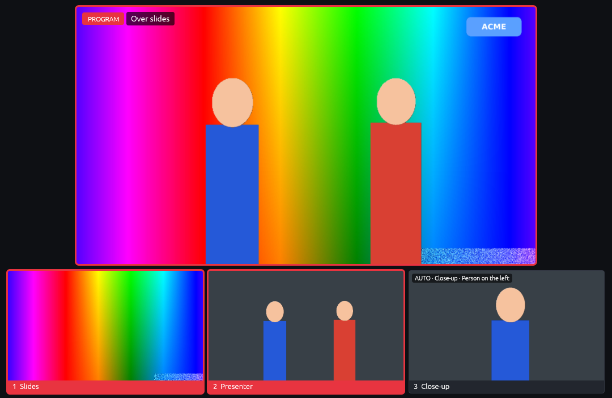

[← The manual](README.md)

# Network, phone and PTZ cameras, framing and backgrounds

## Network sources

In **Sources › Network & phone feeds** (or Cameras), set a source's type to **Network feed**
(then pick SRT or RTMP under **Feed**) or **NDI** and the settings show the
address to send to. To
hear a network source (or the media player), add an audio input whose device
is **Sound from <source name>**.

| Device | What it does | Send to it with |
|---|---|---|
| `rtmp-in:1935/mykey` | Cutaway's own RTMP server, port 1935, stream key `mykey` (leave the key out to accept any) | OBS: Server `rtmp://<this Mac's IP>:1935/live`, key `mykey`. Larix and hardware encoders the same way |
| `srt-in:9000` | Waits for an SRT sender on port 9000 | `srt://<this Mac's IP>:9000` |
| `srt://10.0.0.5:9000` | Calls an SRT listener (another machine, a decoder) | — |
| `ndi:Studio PC (OBS)` | An NDI source by name | Any NDI sender |
| `media` | The media player; files are set in its settings | — |

Senders can use H.264 or HEVC video with AAC sound. Network sources show
"Standing by" until a sender connects, and pick up again if it reconnects. The
source's **Buffer** of 300 ms (the default) suits a wired local network;
raise it for Wi-Fi or the internet.

## Phone cameras

1. **Sources › Guests › ＋ Phone camera** (or a video source of type
   **Phone camera**), then **Apply** on the bar at the bottom. Remote guests turn on with it, for the page the
   phone opens.
2. **Scan the QR code** (in those settings, or **QR** in the main window's
   guests panel) with the phone's camera app, and allow the camera. The phone
   shows its picture and **● Sending** once Cutaway has it.
3. Hold the phone sideways. It uses the back camera at up to 1080p (switch
   lens or to 720p on the phone), keeps its screen on, and reconnects by
   itself if the Wi-Fi drops.

The picture goes straight over your network (the tunnel only carries the
page), so keep the phone on the same Wi-Fi for the best picture. It needs
Safari on iPhone or Chrome on Android (they send H.264, which Cutaway takes).

## PTZ cameras

In **Sources › Cameras**, open a camera's **PTZ camera control**: choose
**VISCA over IP** (Sony and most PTZ cameras, port 52381), **VISCA over
TCP** or **UDP** (PTZOptics and others), or **NDI** for an NDI PTZ camera,
and its address. Save presets there or from the **PTZ** panel in the main
window, which has a joystick (drag from the middle; let go to stop), zoom,
**Home** and preset buttons. The Stream Deck, the remote, MIDI and OSC can
recall presets and move it too.

A **close-up you aim** (a source type; it was called a virtual PTZ camera) is a camera operator inside
another source: it pans, tilts and zooms around that picture (best from a 4K
camera), with presets it glides to in the time you set. It records like any
source, and starts on its first preset.

Its **Record** row says how it's saved:

- **as its own video file** (the usual): a file of what it showed, like any
  camera's.
- **as a crop of Cam 1** (the camera it's cut from): no file of its own, so
  one encoder fewer and less disk. One 4K camera split in two is then
  recorded once, not three times. The editor timelines use Cam 1's file for
  its angle, zoomed in and moved to the same shot, so you can still reframe
  it there. If it moved during the recording, Final Cut gets the moves as
  keyframes; in DaVinci Resolve and Premiere a move cuts to where it ended
  (add keyframes there for a glide). Instant replays from it still show its
  shot, cut from Cam 1's recording, framed as it is when you press Replay.
  This needs Cam 1 itself recorded (otherwise it gets its own file), and
  takes effect from the next recording. Close-ups that follow people always
  get their own file: their shot never stops moving.

Its presets are framed in **Sources › Close-ups & PTZ**: the wide camera's
picture shows each preset as a numbered box, the shot it's on now in red.
Drag a box to move that preset and scroll over the picture to zoom it; the
small picture beside shows what it sends out. **＋ Preset** adds a close-up in
the middle to drag into place. Moving a preset is saved as you go, without
the camera stopping (a new close-up starts once you press Apply).

## Auto-framing and backgrounds (blur, replace, cut out)

*The presenter cut out over the slides (no green screen), and an auto-framed
close-up of the person on the left, cut from the same camera.*

- **Auto-framing:** in **Sources › Cameras**, add a source of type
  **Close-up that follows people** (it was called auto-framed) and pick the wide camera to cut it from, who to
  follow and the shot size (close-up, medium, wide). Add several for several
  people. Use **⋯** on its tile (or right-click it) during the show to change who it follows.
  - Best from a 4K camera: a 1080p close-up cut from 4K stays sharp. **Zoom
    limit** caps how far a smaller picture is enlarged.
  - Small movements are ignored, so the shot holds steady; when someone
    leaves, the frame waits a moment and then widens.
  - The close-up uses the wide camera's frame rate and delay, and is
    recorded to its own file.
- **Blur or replace the background, no green screen:** in a source's
  **Picture adjustments**, tick **Background** and choose what goes behind
  the people: **blurred** (the room softly out of focus, like a portrait
  lens, as strong as you like), **a picture instead** (your own image fills
  the frame behind them), or **cut out** (put the source above slides, a
  background image or another camera in a scene and that shows through).
  **Fast**, **Balanced** and **Best edges** trade speed for finer hair and
  edges. Like the other adjustments it changes the program only; the
  source's own file is untouched.
- On a Mac both use Apple's **Vision** framework on the Neural Engine; on
  Windows, two small open models on the graphics card (see `models/`).
  Nothing leaves the computer.
